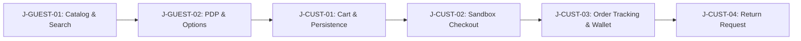
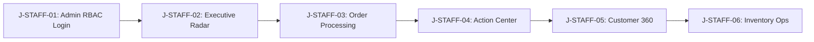

# RUHVI — Critical-Flow Regression Test Map (Phase 03)

**Version:** 1.0  
**Date:** 2026-10-31  
**Project:** Ruhvi E-Commerce (`ruhvi.in`)  
**Reference Plan:** [`RUHVI_TOTAL_MASTER_IMPLEMENTATION_PLAN.md`](./RUHVI_TOTAL_MASTER_IMPLEMENTATION_PLAN.md) — Phase 03  
**Status:** **AUTHORITATIVE REGRESSION SUITE DEFINITION**  
**Safety Boundary:** Sandbox / Mocked environments only. **Zero real payment gateway charges, zero real SMS/WhatsApp dispatches, zero real courier shipments, zero production data deletion.**

---

## 1. Overview & Objective

This document defines the minimum mandatory regression test map for Ruhvi. Every proposed code change, refactor, or optimization across later phases must pass the relevant subset of these regression journeys to ensure zero functional breakage.

The test map spans **14 Canonical Journeys** categorized by actor:
- **Guest Journeys (`J-GUEST-*`):** Unauthenticated storefront navigation, search, catalogue, and product detail.
- **Customer Journeys (`J-CUST-*`):** Cart persistence, checkout flow (sandbox), order tracking, returns, wallet/coins, and GIA AI chat.
- **Staff / Admin Journeys (`J-STAFF-*`):** Authentication & RBAC, Business Radar, Order fulfillment, Return inspections, Action Center, Customer 360, and Inventory operations.

---

## 2. Test Environments & Test Identity Matrix

| Role | Test Identity / User Type | Auth Mechanism | Safe Test Boundary |
|:---|:---|:---|:---|
| **Guest** | Unauthenticated anonymous session | Anonymous cookie / no session | Localhost / Staging read-only |
| **Customer** | `test-customer-01@ruhvi.in` | Firebase Auth (mocked / test project) | Sandbox orders only; dummy payment |
| **Support Staff** | `staff-support@ruhvi.in` | Custom JWT + Staff Session (`role: STAFF`) | Read-only ticket management |
| **Operations Staff** | `staff-ops@ruhvi.in` | Custom JWT + Staff Session (`role: OPERATIONS`) | Inventory scans (staged only) |
| **Administrator** | `admin-qa@ruhvi.in` | Custom JWT (`role: ADMIN` / `SUPER_ADMIN`) | Staging admin routes only |

---

## 3. Canonical Regression Journeys Matrix

### Journey Group A: Storefront & Customer Journeys

#### 1. `J-GUEST-01`: Catalog Browsing, Search & Collections
- **Actor:** Guest (Unauthenticated)
- **Primary Routes:** `/`, `/products`, `/collections/new-arrivals`, `/collections/best-sellers`
- **Prerequisites:** Seeded active products in database.
- **Pass Criteria:**
  - Homepage hero renders without layout shift.
  - Virtual collections (`new-arrivals`, `best-sellers`, `limited`) load products without 404.
  - Price/category filter updates product grid reactively.
  - Free-text search returns relevant product hits.
- **Invariants:** No auth prompt triggered for browsing; no missing image broken icons (`<Image>` fallbacks active).
- **Cleanup:** None (read-only).

#### 2. `J-GUEST-02`: Product Detail Page (PDP) & Variant Selection
- **Actor:** Guest / Customer
- **Primary Routes:** `/products/[slug]`
- **Prerequisites:** Product with variants (sizes, metal finishes) exists.
- **Pass Criteria:**
  - High-res image gallery and PhotoSwipe viewer open cleanly.
  - Dynamic pricing and stock availability update upon size/variant selection.
  - "Add to Cart" and "Buy Now" CTAs are responsive.
- **Invariants:** 22K gold-plated guarantee badge visible; SEO JSON-LD schema renders.
- **Cleanup:** None (read-only).

#### 3. `J-CUST-01`: Cart Mutations & Cross-Tab Persistence
- **Actor:** Customer / Guest
- **Primary Routes:** `/cart`, Cart Drawer Component
- **Prerequisites:** Active products in stock.
- **Pass Criteria:**
  - Add item increments cart badge counter instantly.
  - Quantity updates recalculate subtotal, tax, and estimated delivery dates.
  - Cart contents persist across page refreshes and localStorage.
  - Out-of-stock items block checkout button.
- **Invariants:** Prices match current database values; zero negative quantities allowed.
- **Cleanup:** Clear test cart items after assertions.

#### 4. `J-CUST-02`: Checkout, Coupon & Payment (Sandbox Mode)
- **Actor:** Logged-in Customer
- **Primary Routes:** `/checkout`, `/api/checkout`, `/api/orders`
- **Prerequisites:** Seeded test coupon (`WELCOME10`), test customer address.
- **Pass Criteria:**
  - Address selection or creation succeeds with validation.
  - Valid coupon applies discount; invalid coupon shows clear error.
  - Wallet balance toggle deducts allowable percentage from payable amount.
  - Payment gateway mock returns successful redirect; order created in `pending_payment` -> `confirmed`.
- **Invariants:** **Strictly sandbox/mocked payment tokens only.** Never invoke live PhonePe/Paytm production APIs during regression.
- **Cleanup:** Test order flagged with `is_synthetic_test: true` for automatic archival.

#### 5. `J-CUST-03`: Order Confirmation & Customer Account History
- **Actor:** Logged-in Customer
- **Primary Routes:** `/orders`, `/account`, `/account/wallet`
- **Prerequisites:** Existing customer order.
- **Pass Criteria:**
  - Order details page displays order items, tracking status, and invoice link.
  - Wallet balance matches verified ledger balance.
  - Customer can view rewarded Ruhvi Coins.
- **Invariants:** Customer cannot view another user's order (`user_id` strictly matches authenticated profile UUID).
- **Cleanup:** None.

#### 6. `J-CUST-04`: Customer Returns & Cancellation
- **Actor:** Logged-in Customer
- **Primary Routes:** `/account/returns`, `/api/orders/return`
- **Prerequisites:** Confirmed delivered order within return window.
- **Pass Criteria:**
  - Customer can submit return reason and upload photo attachment.
  - Order status updates to `return_requested`.
  - Notification event dispatched.
- **Invariants:** Ineligible orders (outside window or non-returnable categories) cannot trigger return requests.
- **Cleanup:** Reset test order status.

#### 7. `J-CUST-05`: GIA AI Shopping Concierge Interaction
- **Actor:** Storefront Visitor
- **Primary Routes:** `/api/chat`, Floating GIA Chat Window
- **Prerequisites:** Gemini / AI routing configured with mock or test key.
- **Pass Criteria:**
  - Assistant responds to jewelry questions in English, Bengali, or Hindi.
  - Product recommendation cards link to valid PDP slugs.
  - Rate limiting (30 requests/min) enforces throttle gracefully.
- **Invariants:** Prompt injection defense prevents leaking system prompts or credentials.
- **Cleanup:** Ephemeral chat session discard.

---

### Journey Group B: Staff, Admin & Internal Operations

#### 8. `J-STAFF-01`: Staff Authentication & Role-Based Access Control (RBAC)
- **Actor:** Staff / Admin
- **Primary Routes:** `/admin/login`, `/admin/*`, `/portal-orders/*`, `/operations/*`
- **Prerequisites:** Staff credentials with defined role (`ADMIN`, `OPERATIONS`, `SUPPORT`).
- **Pass Criteria:**
  - 2FA TOTP or role challenge verifies authorized staff.
  - Staff users can access assigned portal routes only.
  - Unauthorized roles receive immediate 403 / redirect.
- **Invariants:** Session token securely stored; `role_permissions` checked on every protected API call.
- **Cleanup:** Session logout.

#### 9. `J-STAFF-02`: Business Radar & Anomaly Detection
- **Actor:** Administrator / Executive
- **Primary Routes:** `/admin/business-radar`, `/api/business-radar`, `/api/anomalies`
- **Prerequisites:** Database populated with recent sales and anomaly records.
- **Pass Criteria:**
  - Dashboard loads Gross Sales, Net Sales, AOV, and Conversion Rate.
  - Open anomalies list displays severity badges, fingerprints, and timestamps.
  - Acknowledging or resolving an anomaly updates durable state in `business_anomalies`.
- **Invariants:** Test orders (`is_synthetic_test = true`) excluded from financial aggregates.
- **Cleanup:** Revert test anomaly state.

#### 10. `J-STAFF-03`: Order Fulfillment & State Progression
- **Actor:** Operations / Orders Manager
- **Primary Routes:** `/portal-orders/all`, `/api/orders/[id]/status`
- **Prerequisites:** Confirmed test order.
- **Pass Criteria:**
  - Order state advances: `confirmed` -> `processing` -> `shipped` -> `delivered`.
  - Canonical order lifecycle event emitted on each transition.
  - Tracking AWB updates correctly.
- **Invariants:** Invalid transitions (e.g. `delivered` -> `confirmed`) rejected by status engine.
- **Cleanup:** Archive test order.

#### 11. `J-STAFF-04`: Action Center Proposal Review & Simulation
- **Actor:** Executive / Administrator
- **Primary Routes:** `/admin/action-center`, `/api/action-center/simulate/[id]`
- **Prerequisites:** Pending action proposal in `action_proposals`.
- **Pass Criteria:**
  - Proposal details and telemetry preview load dynamically for the given ID.
  - Simulation calculates projected revenue/impact without applying changes.
  - Human approval gate records staff user ID and timestamp.
- **Invariants:** No unapproved execution; arbitrary shell or SQL commands strictly blocked.
- **Cleanup:** Mark test proposal status as `simulated`.

#### 12. `J-STAFF-05`: Customer 360 Profile & Audited Access
- **Actor:** Support Manager / Administrator
- **Primary Routes:** `/admin/customer-360/[id]`, `/api/customer-360/[id]`
- **Prerequisites:** Existing customer record.
- **Pass Criteria:**
  - Customer order timeline, lifetime value, and support tickets load.
  - PII masking applied according to viewer role (Support sees masked phone/email; Admin sees full).
  - Every view generates an audit log entry in `audit_logs` table.
- **Invariants:** Privileged read audit log cannot be bypassed.
- **Cleanup:** None.

#### 13. `J-STAFF-06`: Inventory Operations & Staging Scan
- **Actor:** Warehouse / Operations Staff
- **Primary Routes:** `/operations/inventory`, `/api/operations/inventory/intelligence`
- **Prerequisites:** Products with SKU barcodes.
- **Pass Criteria:**
  - Barcode scan stages item with authenticated `client_scan_id`.
  - Operations intelligence banner displays SKU demand and stockout risk estimates.
  - Concurrent scans for distinct users do not collide.
- **Invariants:** Manual sync retains operator identity; stock cannot decrement below zero without override flag.
- **Cleanup:** Discard staged test scan records.

#### 14. `J-STAFF-07`: AI Co-Founder Workspace & Voice Session
- **Actor:** Administrator
- **Primary Routes:** `/admin/co-founder`, `/api/admin/co-founder/chat`
- **Prerequisites:** Valid LiveKit / Gemini credentials or mock runner.
- **Pass Criteria:**
  - Co-Founder loads persistent memories and strategic brief.
  - Live voice session initializes room and issues token.
  - Audio capture and transcript playback execute within acceptable latency.
- **Invariants:** Global security header permits microphone on origin (`microphone=(self)`).
- **Cleanup:** End voice session.

---

## 4. Regression Execution Strategy

| Implementation Phase Group | Mandatory Regression Journeys to Run |
|:---|:---|
| **Track B (Security & Access)** | `J-STAFF-01` (RBAC), `J-CUST-02` (Wallet), `J-STAFF-07` (Mic) |
| **Track D (Canonical Events)** | `J-CUST-02` (Checkout), `J-STAFF-03` (Fulfillment), `J-STAFF-02` (Radar) |
| **Track E & F (Metrics & Action)** | `J-STAFF-02` (Radar), `J-STAFF-04` (Action Center) |
| **Track I (Inventory)** | `J-STAFF-06` (Inventory Ops) |
| **Track J (AI Co-Founder)** | `J-STAFF-07` (Co-Founder & Voice), `J-CUST-05` (GIA) |
| **Track K (Storefront)** | `J-GUEST-01`, `J-GUEST-02`, `J-CUST-01`, `J-CUST-03` |
| **Track M (Final Release)** | **All 14 Journeys (`J-GUEST-01` through `J-STAFF-07`)** |

---

## 5. Pass/Fail Governance

- **BLOCKER:** Any regression failure in checkout (`J-CUST-02`), authentication (`J-STAFF-01`), or order integrity halts all further phase execution.
- **MAJOR:** Any regression in dashboard metrics (`J-STAFF-02`) or inventory staging (`J-STAFF-06`) must be fixed before proceeding to the next track.
- **WARNING:** Non-blocking styling or tooltip glitches may be queued as immediate follow-up tasks.

