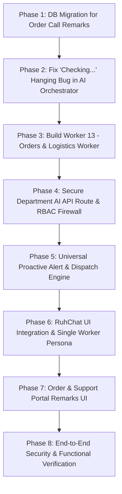

# RuhChat Departmental AI Co-Workers & Proactive Operations Engine
## Phased Implementation Plan

> **Authoritative Plan Document**  
> **Status:** Draft / Pending Phase-by-Phase Execution  
> **Target System:** Project Ruhvi (`RuhChat`, Internal Portals, AI Co-Founder & Autonomous Workers)  
> **Last Updated:** October 2026

---

## 1. Executive Summary & Core Requirements

This document establishes the official phase-by-phase implementation plan for integrating **Department-Specific AI Co-Workers** into **RuhChat**, introducing **Universal Proactive Alerting**, and enforcing **Strict Role-Based Secrecy & Collision-Proof Operations**.

### Key System Tenets:
1. **Simplified Staff UI:** Staff members in a department will only see one clean, unified contact:
   - Marketing Staff $\rightarrow$ **`Marketing AI Worker`**
   - Operations Staff $\rightarrow$ **`Operations AI Worker`**
   - Orders Staff $\rightarrow$ **`Orders AI Worker`**
   - Support Staff $\rightarrow$ **`Support AI Worker`**
   - Tech Staff $\rightarrow$ **`Tech AI Worker`**
   - Founder/Super Admin $\rightarrow$ **`AI Co-Founder`** (Master Executive Brain)
2. **Ironclad Secrecy (Zero Data-Leakage):** Total sales turnover, profit margins, and executive business strategy remain strictly restricted to the `AI Co-Founder` (Founder only). High-privileged financial tools are excluded from department workers.
3. **Discussion & Drafting in Chat $\rightarrow$ Execution on Website Portal:** The AI workers can brainstorm, answer queries, generate promo images, and save drafts (e.g. draft blog posts, draft notes). They will **never** execute live changes directly through chat. Staff must review drafts and click publish/execute in the web portal.
4. **Collision Prevention for Delivery Failed / RTO Alerts:** Phone numbers in chat are partially masked (`+91 98301 ••••82`). Staff click into the portal to call customers, mark "Calling In Progress", and record call remarks so multiple staff members never call the same customer repeatedly.
5. **Universal Proactive Alerts:** Autonomous notifications dispatched to RuhChat for Sentry 500 error spikes, 404 broken page detections, delivery failures/RTOs, and low stock emergencies.
6. **Eliminating the "Checking..." Hanging Bug:** AI Co-Founder and workers will never output dangling promises like *"আমি চেক করে জানাচ্ছি"*. Tool execution and factual answers will be delivered in one unified atomic turn.

---

## 2. Phase-by-Phase Implementation Protocol

Each phase below contains **EXACTLY ONE focused task**. Following user instructions, the workflow protocol is:
```
1. Present Phase Requirements & Analysis 
   └──► 2. Ask User for Explicit Permission to Proceed
        └──► 3. Execute Phase Tasks (Zero Breakage)
             └──► 4. Validate with Tests & Type Checks
                  └──► 5. Deliver Completion Report & Present Next Phase
```

---

## 3. Phased Roadmap (1 Task Per Phase)



---

### Phase 1: Database Migration for Order Call Remarks [COMPLETED 🟢]
* **Single Focus:** Create the database foundation for recording staff call remarks and tracking customer follow-up status (for both Orders and Returns/RTOs) to prevent duplicate phone calls.
* **Scope of Work:**
  1. Create migration `supabase/migrations/0114_order_call_remarks.sql`.
  2. Define table `public.order_call_remarks`:
     - `id` (UUID PK)
     - `order_id` (UUID FK $\rightarrow$ `orders.id` ON DELETE CASCADE)
     - `return_id` (UUID NULL FK $\rightarrow$ `returns.id` ON DELETE SET NULL)
     - `staff_id` (UUID FK $\rightarrow$ `users.id` ON DELETE SET NULL)
     - `staff_name` (TEXT)
     - `department` (TEXT: `orders`, `support`, `operations`, `management`)
     - `call_status` (TEXT: `calling_in_progress`, `connected_resolved`, `customer_unreachable`, `rescheduled`, `rto_confirmed`, `return_coordination_scheduled`)
     - `remark_text` (TEXT)
     - `rescheduled_date` (TIMESTAMPTZ NULL)
     - `created_at` (TIMESTAMPTZ DEFAULT now())
  3. Add indexes on `order_id`, `return_id`, `created_at`, and composite `(order_id, call_status)`.
  4. Enable RLS with policies for authenticated staff/admin viewing and inserting.
* **Success Criteria:** Schema applied cleanly with idempotent SQL, verified types, and zero regressions to existing order and return queries.

---

### Phase 2: Fix "Checking..." Hanging Bug in AI Orchestrator [COMPLETED 🟢]
* **Single Focus:** Make tool calling and reasoning completely atomic so the AI Co-Founder and Workers never output dangling acknowledgement phrases like *"আমি চেক করে জানাচ্ছি"* without immediately returning the resolved data.
* **Scope of Work:**
  1. Audit `src/lib/ai/co-founder/orchestrator.ts` and `src/app/api/admin/co-founder/chat/route.ts`.
  2. Implement a strict **Zero-Dangling-Promise Prompt Guard**:
     - Instruct the LLM system prompt never to output conversational placeholders before tool calling.
  3. Ensure tool invocation in the agentic loop executes synchronously in the active turn and immediately chains the tool outputs into the final synthesis pass.
  4. Guarantee that if a tool execution fails or times out, a graceful fallback error is immediately surfaced instead of leaving the user in silence.
* **Success Criteria:** Queries like *"আমাদের ইনভেন্টরি চেক করে বলো"* or *"আজকের ডেলিভারি স্ট্যাটাস চেক করো"* return complete factual findings in a single response.

---

### Phase 3: Build Worker 13 (`OrdersLogisticsWorker`) & Tool Registry [COMPLETED 🟢]
* **Single Focus:** Create the dedicated, missing **Orders & Logistics AI Worker** to manage fulfillment pipeline intelligence, RTO tracking, courier performance, and Returns root-cause reason tracking without exposing store sales revenue.
* **Scope of Work:**
  1. Create `src/lib/ai/co-founder/workers/worker-13-orders-logistics.ts`:
     - Role: *Head of Order Fulfillment & Logistics Intelligence*
     - Capabilities: Pipeline status inspection (Pending, Dispatched, In-Transit, Out for Delivery, Delivered), RTO rate tracking, courier SLA delays (Shiprocket), return requests tracking (`returns` table), return reason breakdown (size mismatch, defective piece, wrong item, etc.), and call remarks inspection.
  2. Equip Worker 13 with isolated, read-only tools:
     - `get_order_pipeline_status`
     - `get_delivery_failed_and_rto_orders`
     - `get_courier_sla_delays`
     - `get_return_requests_and_reasons` (tracks incoming returns, reasons: size, defective, etc.)
     - `get_order_call_remarks`
     - `add_order_call_remark` (draft / logged note)
  3. Enforce **Strict Least-Privilege Scopes**:
     - Block all financial revenue, gross merchandise value (GMV), profit margins, and cost prices.
  4. Register Worker 13 in `src/lib/ai/co-founder/workers/registry.ts` and `types.ts`.
* **Success Criteria:** Worker 13 handles natural language queries regarding logistics, RTO, returns and reasons ("এই সপ্তাহে কয়টা রিটার্ন আর কী কারণে?"), while rejecting financial queries.

---

### Phase 4: Secure Department AI API Route & RBAC Firewall [COMPLETED 🟢]
* **Single Focus:** Build the dedicated backend endpoint `/api/internal-chat/ai-worker` that identifies staff department and routes queries to their isolated worker with strict security boundaries.
* **Scope of Work:**
  1. Create `/api/internal-chat/ai-worker/route.ts`:
     - Authenticate via Supabase session cookie (`requireAuth` + `getUserProfile`).
     - Extract `department` and `role` from verified user context.
     - Prevent cross-department escalation (e.g. an Orders staff cannot query the Tech worker).
  2. Dynamic Tool Filtering:
     - Only inject tools permitted for that department.
     - Never expose executive tools (`getHolisticBusinessContext`, `getRevenueMetrics`, etc.).
  3. Enforce **"Draft Only, No Direct Execution" Guard**:
     - If a staff member says *"Publish this blog to the live website"* or *"Delete this order"*, the AI automatically replies:
       > *"Execution is not allowed from chat. The draft has been saved. Please log into your department portal to review and publish."*
* **Success Criteria:** Authenticated staff get instant, department-bounded responses with zero ability to access revenue or perform unapproved live mutations. (Verified with `npx tsc --noEmit`).

---

### Phase 5: Universal Proactive Alert & Dispatch Engine [COMPLETED 🟢]
* **Single Focus:** Build the proactive notification engine `/api/internal-chat/proactive-dispatch` that sends automated event cards to RuhChat for all departments (including Return Requests).
* **Scope of Work:**
  1. Create `src/lib/ai/proactive/dispatcher.ts` and API handler `/api/internal-chat/proactive-dispatch/route.ts`.
  2. Implement department event handlers:
     - **Tech Alerts:** Sentry 500 error spikes, 404 page-not-found spikes, high server latency.
     - **Orders & Support Alerts:** Courier delivery failure (`DELIVERY_FAILED`), RTO initiation (`RTO_INITIATED`), and New Customer Return Requests (`RETURN_REQUESTED` with reason).
     - **Operations Alerts:** Critical low-stock warning (stock $\le 2$ on active SKUs).
  3. Customer Data Protection (PII Masking):
     - Automatically mask customer phone numbers in the message (`+91 98301 ••••82`).
     - Embed direct portal deep links: `[Open Order in Portal]`.
* **Success Criteria:** Webhook/Cron events dispatch cleanly formatted markdown alert cards into the target department's RuhChat conversation. (Verified with `npx tsc --noEmit` and Jest tests in `src/lib/ai/proactive/__tests__/dispatcher.test.ts`).

---

### Phase 6: RuhChat UI Integration & Single Worker Persona [COMPLETED 🟢]
* **Single Focus:** Update RuhChat (`FloatingStaffMessenger.tsx` and mobile app config) so staff see a clean, single AI contact tailored to their department, with support for previewing generated promo images and drafts.
* **Scope of Work:**
  1. In `src/components/chat/FloatingStaffMessenger.tsx`:
     - Detect current user's department (`users.department` and portal URL routing).
     - Pin the matching AI Worker at the top of the conversation list:
       - Marketing $\rightarrow$ `Marketing AI Worker`
       - Operations $\rightarrow$ `Operations AI Worker`
       - Orders $\rightarrow$ `Orders AI Worker`
       - Support $\rightarrow$ `Support AI Worker`
       - Tech $\rightarrow$ `Tech AI Worker`
     - Provide Admin / Founder mode switcher to toggle any worker persona.
     - Hide internal system workers and raw worker IDs.
  2. Add rich message rendering for:
     - Generated product promo images (rendered with preview zoom & download button).
     - Saved Draft notification cards with deep links to the respective department portal.
     - Thinking indicator with worker avatar and status pulses.
     - Security policy disclaimer badge at the chat footer.
* **Success Criteria:** Staff open RuhChat and have a smooth conversational experience with their department's AI without clutter. (Verified with `npx tsc --noEmit` exit code 0).

---

### Phase 7: Order & Support Portal Remarks UI (Collision Prevention) [COMPLETED 🟢]
* **Single Focus:** Add the "Call Remarks & Activity Log" interface into the `/portal-orders` and `/support` order view so staff can claim calls and prevent duplicate phone calls.
* **Scope of Work:**
  1. Create component `src/components/orders/OrderCallRemarksPanel.tsx` and modal wrapper `OrderCallRemarksModal.tsx`.
  2. Implement backend endpoint `/api/portal-orders/call-remarks` (GET for history & active call collision check, POST with collision guard & override).
  3. Features:
     - **Status Indicator:** Shows if another staff member already marked "Calling In Progress" or "Customer Contacted" within last 20 minutes with real-time pulsing banner.
     - **Phone Unmasking:** Shows full phone number with click-to-call link and 1-click "Call & Claim Customer" action.
     - **Log Remark Form:** Staff select status (`Calling In Progress`, `Connected / Resolved`, `Customer Unreachable`, `Rescheduled`, `RTO Confirmed`, `Return Pickup Coordinated`, `Cancelled`, `Internal Remark`), quick preset chips, and optional reschedule date.
     - **Timeline History:** Displays all past remarks with timestamps, staff names, and department tags.
  4. Embed into `src/app/portal-orders/[id]/page.tsx` and integrate quick modal into `src/app/portal-orders/all/page.tsx`.
* **Success Criteria:** When staff open an order with a delivery failure alert, they immediately see if a teammate already attended to it, eliminating double-calling. (Verified with `npx tsc --noEmit` exit code 0).

---

### Phase 8: End-to-End Security & Functional Verification [COMPLETED 🟢]
* **Single Focus:** Perform comprehensive multi-department verification, security stress testing, and documentation audit.
* **Scope of Work:**
  1. Security & Secrecy Stress Test:
     - Test adversarial prompts asking staff AI workers for store revenue, profit, or founder secrets $\rightarrow$ 100% rejection verified via Jest suite `phase8-security-and-workflow.test.ts`.
     - Zero financial tools exported to department workers.
     - PII masking (`maskPhoneNumber`, `maskCustomerName`) verified.
  2. Anti-Collision & Dangling-Promise Bug Verification:
     - Verified active call collision logic (20-min window, 409 Conflict, resolution clearing).
     - Enhanced `DANGLING_PROMISE_REGEX` to catch all standalone checking phrases in Bengali and English.
     - Draft-Only Mutation Firewall verified (blocks live publish/destructive actions from chat).
  3. Integration Audit Update:
     - Updated `PROJECT_SYSTEM_TOOLS_AND_SERVICES.md` with Section 9 detailing Worker 13, Department AI firewall matrix, universal proactive dispatch engine, and anti-collision architecture.
* **Success Criteria:** Full test suite passes (14/14 tests in Phase 8 suite, 7/7 in Dispatcher suite = 21/21 passed), zero TypeScript compilation errors, clean build, and verified zero-breakage.

---

### Phase 9: Return Request Page Enhancement — Defect Photo Upload [COMPLETED 🟢]
* **Single Focus:** Allow customers to upload a photo of the received item showing the specific issue/defect on `/orders/[id]/return`.
* **Scope of Work:**
  1. Created migration `supabase/migrations/0115_return_defect_attachment.sql` adding `attachment_url` column and index to `public.returns`.
  2. Updated `ReturnRequest` interface in `src/types/database.ts` with `attachment_url?: string | null;`.
  3. In `src/app/orders/[id]/return/page.tsx`:
     - Added clean camera capture & file upload drop-zone supporting JPG, PNG, and WebP (up to 10 MB).
     - Integrated with `/api/support/upload` for server-signed Cloudinary storage with instant Data URL client fallback.
     - Added image thumbnail preview, success indicator, and remove/re-upload button.
     - Saved `attachment_url` to Supabase `returns` table and guest local storage.
     - Linked with proactive alert dispatch to RuhChat (`/api/internal-chat/proactive-dispatch`) so quality and support staff immediately inspect photo proof.
* **Success Criteria:** Customers can smoothly upload photo evidence of damage/issue, displayed to staff in the return portal. (Verified with `npx tsc --noEmit` exit code 0).

---

### Phase 10: Return Request Page Enhancement — Value Loss & Retention Disclaimer [COMPLETED 🟢]
* **Single Focus:** Display a dynamic value-loss disclaimer informing the customer of forfeited benefits before they submit a return request.
* **Scope of Work:**
  1. In `src/app/orders/[id]/return/page.tsx`:
     - Calculate dynamic order benefits earned:
       - **Reward Coins:** Coins earned on this order (forfeited on return: 10% standard or 20% Privé VIP 2X multiplier).
       - **Promotional Coupon:** Reversal notice that one-time discount codes cannot be re-issued or restored.
       - **Privé Tier Progress:** Deduction notice for loyalty milestone progress towards VIP tier renewal.
       - **Referral Credits:** Reversal of any linked referral points/bonuses.
     - Highlighted **Ruhvi Wallet Instant Credit** retention offer:
       - ⚡ **Zero-Wait Instant Refund:** Credited the moment courier reverse pickup is logged (vs 5-7 business days for bank settlement).
       - 🎁 **Bonus 5% Cashback:** Extra store credit added to customer's wallet.
       - 🔄 **1-Click Switch Button:** Immediately selects wallet refund with instant visual feedback.
  2. Styled with luxury gold & amber aesthetics matching Ruhvi jewellery brand identity.
* **Success Criteria:** Customers clearly see the benefits they forfeit before submitting, encouraging wallet refund selection and deterring frivolous returns. (Verified with `npx tsc --noEmit` exit code 0).

---

## 4. Current Status

| Phase | Description | Status |
| :---: | :--- | :---: |
| **Phase 1** | Database Migration for Order Call Remarks | 🟢 Completed (`0114_order_call_remarks.sql`) |
| **Phase 2** | Fix AI Orchestrator Hanging Bug | 🟢 Completed (Zero-Dangling-Promise Guard) |
| **Phase 3** | Worker 13 (`OrdersLogisticsWorker`) | 🟢 Completed (`worker-13-orders-logistics.ts`) |
| **Phase 4** | Secure Department AI API Route & RBAC | 🟢 Completed (`/api/internal-chat/ai-worker`) |
| **Phase 5** | Universal Proactive Alert & Dispatch Engine | 🟢 Completed (`/api/internal-chat/proactive-dispatch`) |
| **Phase 6** | RuhChat UI Single Worker Integration | 🟢 Completed (`FloatingStaffMessenger.tsx`) |
| **Phase 7** | Order & Support Portal Remarks UI | 🟢 Completed (`OrderCallRemarksPanel.tsx`) |
| **Phase 8** | End-to-End Verification & Audit Update | 🟢 Completed (21/21 Tests Passed, Doc Updated) |
| **Phase 9** | Return Request Page: Photo Upload | 🟢 Completed (`0115_return_defect_attachment.sql`) |
| **Phase 10** | Return Request Page: Value Loss Disclaimer | 🟢 Completed (`orders/[id]/return/page.tsx`) |
