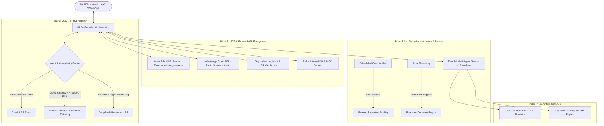
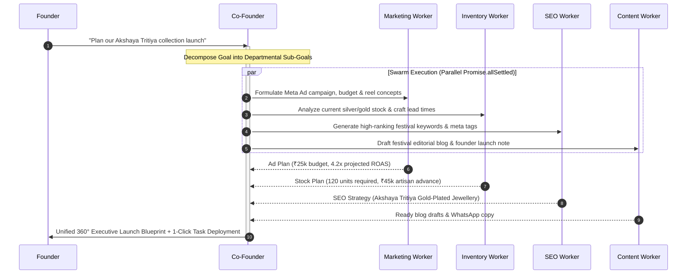

# Ruhvi AI Co-Founder: Next-Gen Evolution & Intelligence Upgrade Master Plan
**Author:** AI Architect & Executive Engineering Team  
**Target Repository:** Project Ruhvi (`c:\Users\INDIA\Desktop\Project Ruhvi`)  
**Scope:** Architecture, Reasoning Brain, MCP Connectors, Proactive Autonomy, and Multi-Agent Swarm  
**Status:** Approved for Implementation Roadmap  

---

## 1. Executive Summary & Strategic Vision

Project Ruhvi already features an advanced **12-Agent AI Co-Founder** with real-time Supabase access, Playwright competitor scraping, closed-loop outcome verification, and the Gemini-powered Studio Photography Engine.

However, moving from a **reactive assistant** (that only answers when spoken to) to an **autonomous, proactive, and deeply analytical Co-Founder** requires elevating the system across six strategic pillars:



---

## 2. Pillar 1: Dual-Tier Hybrid Reasoning Brain

### Current Limitation:
The system currently relies predominantly on fast flash models (`gemini-flash` / `gemini-3.5-flash-lite`) to optimize for live latency. While ideal for snappy voice conversation, complex business decisions (e.g., pricing margins, festival stock capital allocation, and root-cause diagnostics) require deep multi-step reasoning.

### The Solution:
Implement a **Tri-Tier Brain Architecture**:

| Tier | Model | Role / Use Case | Latency / Context |
| :--- | :--- | :--- | :--- |
| **Tier 1: High-Speed Voice & Live Chat** | `gemini-2.5-flash` | LiveKit WebRTC voice streaming, greetings, quick order lookups, and inventory checks. | < 500ms, streaming SSE |
| **Tier 2: Deep Strategic Reasoning (Primary)** | `gemini-2.5-pro` | Root-cause analysis (RCA), quarterly financial planning, margin optimization, and multi-step campaign formulation with **Extended Thinking Budget**. | 2M context, deep analytical synthesis |
| **Tier 3: Reasoning Fallback & Mathematical Logic** | `deepseek-reasoner` (DeepSeek-R1) | Fallback reasoning engine when Gemini quotas are hit or for dedicated mathematical unit economics / pricing logic via Chain-of-Thought. | Chain-of-Thought reasoning, high cost-efficiency |

### Implementation Details:
1. **Model Complexity Router** in `src/lib/ai/co-founder/orchestrator.ts`:
   - Detects whether the query is conversational (greeting/lookup) or strategic (financial/RCA/multi-step).
   - Dynamically selects `gemini-2.5-flash` or `gemini-2.5-pro`.
2. **DeepSeek-R1 Fallback Bridge**:
   - Updates `src/lib/ai/providers/deepseek.ts` to support streaming Chain-of-Thought (`reasoning_content`) from `deepseek-reasoner`.
   - Seamlessly activates when Gemini returns rate-limit (`429`) or server errors (`503`).

---

## 3. Pillar 2: MCP (Model Context Protocol) & External API Connectors

The Founder requested a comprehensive audit of external connectors, specifically identifying what is required for Meta Ads and other platforms.

### A. Direct Official Meta Ads MCP Server (`https://mcp.facebook.com/ads`)

#### Architecture Decision: Direct Meta MCP (No Third-Party Intermediaries)
Instead of using third-party wrappers like Pipeboard, Project Ruhvi connects **directly to Meta's first-party Ads MCP Server** hosted on Meta's infrastructure:
- **Official Remote Endpoint:** `https://mcp.facebook.com/ads`
- **Protocol:** Standard Model Context Protocol (MCP) over HTTPS/SSE
- **Meta App ID:** `1516695129765369` (Provided & Configured)
- **Advantages over Pipeboard:**
  1. **Zero Third-Party Risk:** Direct connection to Meta servers with no intermediary storing access tokens or analytics data.
  2. **100% Native Compatibility:** Instant synchronization with Meta Marketing API updates and official schema definitions.
  3. **High Security:** Secure OAuth / Permanent System User token authentication directly authorized against Meta Business Manager.

#### Key Capabilities Exposed to Co-Founder:
- **Campaign & Ad Analytics:** Query live ROAS, CPC, CTR, spend per campaign/ad set, and identifying "fatigued" creatives.
- **Budget Management:** Scale daily budget on high-performing ad sets or reduce budget on losing sets.
- **Automated Ad Drafting:** Upload generated Studio Photography images directly to Meta Ad Library and draft dark-post ads (set as `PAUSED` by default for Founder approval).
- **Creative Audit:** Compare creative engagement against benchmark metrics.

#### Exact Credentials & Current Configuration Status:
1. **Meta Developer App ID:** `1516695129765369` ✅ *(Provided & Saved to `.env.local`)*
2. **Official Endpoint:** `https://mcp.facebook.com/ads` ✅ *(Configured)*
3. **Permissions / Scopes Needed in Meta Developer App:**
   - `ads_read`: View campaigns, ad sets, ads, and performance metrics.
   - `ads_management`: Create and pause ads, adjust daily budgets.
   - `read_insights`: Pull granular ROAS, conversion value, and spend data.
4. **Permanent System User Access Token:** *(Pending from Founder: Generate in Meta Business Suite > Business Settings > System Users)*
5. **Ad Account ID:** *(Pending from Founder: formatted as `act_XXXXXXXXXXXXX`)*

---

### B. WhatsApp Business Cloud API (Direct Founder Channel)

#### What It Is:
Direct bidirectional communication channel between Founder and AI Co-Founder on WhatsApp.

#### Key Capabilities:
- Send voice notes or text instructions to Co-Founder on WhatsApp while traveling.
- Receive the 9:00 AM Daily Executive Voice Briefing directly as a WhatsApp audio note.
- High-priority instant alerts (e.g., payment gateway drop, stock depletion) delivered directly to Founder's phone with "One-Click Approve" buttons.

#### Exact Credentials & Requirements Needed from Founder:
1. **Meta WhatsApp Business Account (WABA):** Created in Meta Business Suite.
2. **Dedicated WhatsApp Phone Number:** A phone number not currently registered on personal WhatsApp.
3. **Phone Number ID & WABA ID:** Found in WhatsApp Developer Console.
4. **Permanent System User Token:** With `whatsapp_business_messaging` permission.

---

### C. Shiprocket Logistics API & Webhook Bridge

#### Current Status in Project Ruhvi:
Ruhvi already has Shiprocket credentials integrated in `src/lib/shiprocket.ts` for label creation.

#### Enhancement for Co-Founder Intelligence:
1. **Proactive SLA Tracking:** Co-Founder monitors unpicked orders past 24 hours and flags delayed couriers (e.g., Delhivery / Blue Dart transit delays).
2. **RTO (Return to Origin) Early Warning:** Identifies high-risk COD orders with incomplete addresses or non-responsive phone numbers before dispatch.
3. **Credentials Already Available:** `SHIPROCKET_EMAIL`, `SHIPROCKET_PASSWORD`.

---

## 4. Pillar 3: Proactive Autonomy & Anomaly Alert Engine

### 1. Morning Executive Briefing (9:00 AM IST Daily)
- **Mechanism:** Automated server cron job running via Vercel Cron or Supabase `pg_cron` at `03:30 UTC` (9:00 AM IST).
- **Execution Workflow:**
  1. Co-Founder pulls data from past 24 hours: Total sales, orders fulfilled, AOV, active VIP Privé members.
  2. Queries Meta Ads MCP for yesterday's ad spend and blended ROAS.
  3. Checks inventory for any SKU with `Days of Inventory (DOI) < 3`.
  4. Generates a crisp, spoken Bengali/English audio briefing and structured text card.
  5. Dispatches notification to Ruhvi Mobile App and Founder's WhatsApp.

### 2. Real-Time Anomaly Detection Engine
Runs in the background every 15 minutes checking critical store health:
- **Payment Gateway Health:** If 3 consecutive UPI/PhonePe transactions fail within 15 minutes, trigger critical severity alert.
- **Cart Abandonment Spike:** If checkout abandonment exceeds 80% over 2 hours, investigate if shipping fee or coupon errors are causing friction.
- **Sudden Inventory Depletion:** If a popular product sells 5+ units in an hour, recalculate DOI and flag restock urgency.

---

## 5. Pillar 4: Autonomous Multi-Agent Swarm Collaboration

### Current Architecture:
Workers are dispatched individually or sequentially.

### Upgrade: Parallel Swarm Architecture
When a high-level strategic instruction is given (e.g., *"Plan our Akshaya Tritiya jewellery collection launch"*), the Co-Founder acts as Master Orchestrator, executing a parallel swarm:



---

## 6. Pillar 5: Predictive Analytics & Domain-Specific AI

### 1. Festival & Seasonal Demand Forecasting
- Jewellery sales in India surge dramatically during festive periods (Akshaya Tritiya, Karwa Chauth, Dhanteras, Diwali, Wedding Season).
- Co-Founder will incorporate historical Indian festive calendar dates and correlate past sales trends to recommend pre-stocking 30 days prior.

### 2. AOV Optimization & Dynamic Bundle Recommendation
- Co-Founder inspects frequently co-purchased items (e.g., Kundan Choker + matching Pearl Drop Earrings).
- Generates dynamic bundle suggestions with built-in 10% combo discounts, increasing average order value from ₹1,200 to ₹1,800+.

---

## 7. Pillar 6: Real-Time Multimodal Voice & Barge-In Experience

### Upgrade Plan for WebRTC LiveKit Voice:
1. **Natural Interruption (Barge-In):** When the Founder interrupts verbally, the audio playback cuts instantly (<100ms) and the microphone picks up the new query without acoustic echo.
2. **Colloquial Bengali/Banglish Phonics:** Refined voice prompt tuning ensuring natural pronunciation of local terms ("রূহভি", "সেলস", "অর্ডার", "টাকা", "ঝুমকো") without robotic phrasing.
3. **Multimodal File Drop during Voice:** Dragging a competitor screenshot or supplier invoice into the workspace while speaking immediately injects the visual context into the live conversation turn.

---

## 8. Implementation Phases & Milestones

| Phase | Title | Core Deliverables | Target Timeline |
| :---: | :--- | :--- | :---: |
| **Phase 1** | **Dual-Tier Reasoning Brain** | • Update `orchestrator.ts` with complexity router<br>• Configure `gemini-2.5-pro` for deep thinking<br>• Configure `deepseek-reasoner` (R1) streaming fallback<br>• Add DeepSeek API key configuration | Week 1 |
| **Phase 2** | **External Connectors (Meta & Shiprocket)** | • Integrate Meta Ads MCP Server / Direct API bridge<br>• Expose ad metrics & budget controls to Co-Founder<br>• Integrate Shiprocket courier delay tracking | Week 2 |
| **Phase 3** | **Proactive Autonomy & Morning Briefings** | • Implement 9:00 AM IST Cron job in `task-scheduler.mjs`<br>• Real-time Anomaly Detection engine<br>• Mobile push notification dispatch | Week 3 |
| **Phase 4** | **Autonomous Swarm & Parallel Execution** | • Multi-agent parallel swarm orchestrator<br>• 360° campaign execution synthesizer<br>• Automated Ruhvi Task Manager batch delegation | Week 4 |
| **Phase 5** | **WhatsApp Direct Co-Founder Channel** | • WhatsApp Cloud API webhook receiver<br>• Bi-directional voice note & text processing<br>• Executive 1-click approvals via WhatsApp | Week 5 |
| **Phase 6** | **Live Voice Barge-in & Studio V2** | • LiveKit barge-in & interruption handling<br>• Multimodal drag-and-drop live voice integration | Week 6 |

---

## 9. Required Credentials & Inputs from the Founder

To implement this plan smoothly, the Founder will need to provide the following API keys and platform access credentials:

```ini
# 1. Deep Strategic Reasoning (Configured in .env.local ✅)
DEEPSEEK_API_KEY="sk-your-deepseek-api-key"  # DeepSeek-R1 (deepseek-reasoner) Fallback active

# 2. Meta Ads MCP & Marketing Connector (mcp.facebook.com/ads)
META_APP_ID="1516695129765369"                          # Meta App ID Configured ✅
META_ADS_MCP_URL="https://mcp.facebook.com/ads"         # Direct Official Meta MCP Server ✅
META_SYSTEM_USER_ACCESS_TOKEN="EAA..."                  # Pending: Permanent System User token (ads_read, ads_management)
META_AD_ACCOUNT_ID="act_XXXXXXXXXXXXX"                  # Pending: Your primary Meta Ad Account ID

# 3. WhatsApp Business Cloud API (For WhatsApp Channel)
WHATSAPP_PHONE_NUMBER_ID="your_phone_id"
WHATSAPP_BUSINESS_ACCOUNT_ID="your_waba_id"
WHATSAPP_ACCESS_TOKEN="EAA..."                          # Token with whatsapp_business_messaging
FOUNDER_WHATSAPP_PHONE="+91XXXXXXXXXX"                  # Founder's personal WhatsApp number for briefings

# 4. Google Gemini (Existing in Ruhvi)
GEMINI_API_KEY="AIzaSy..."                              # For gemini-2.5-pro & gemini-2.5-flash
```

---

*This document is saved directly in the project root as `RUHVI_AI_COFOUNDER_EVOLUTION_IMPLEMENTATION_PLAN.md` and will serve as the master technical blueprint for all subsequent AI Co-Founder enhancements.*
