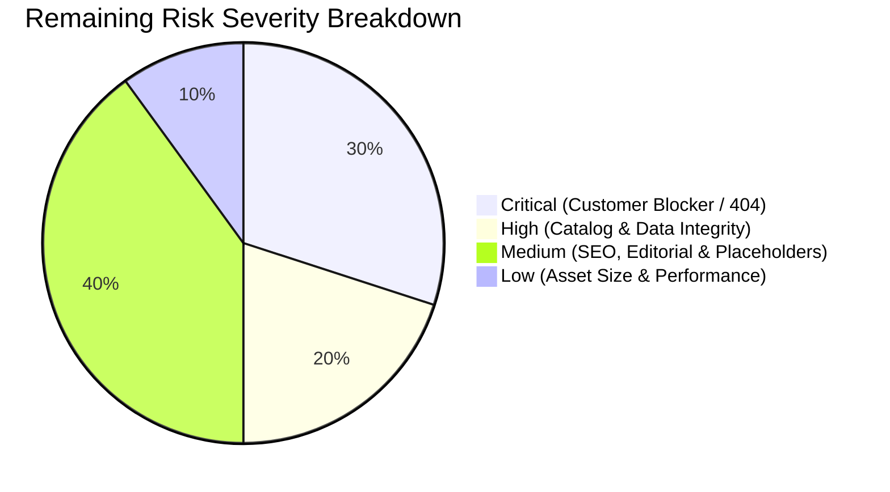
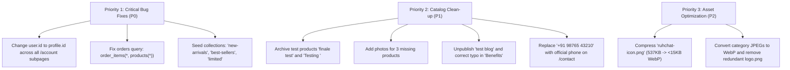

# Comprehensive Storefront & System Audit Master Report: Project Ruhvi

**Audit Date:** October 15, 2026  
**Audit Scope:** Unified Storefront, Authenticated System & Live Edge Production Audit  
**Target Environments:**  
- **Live Production:** `https://ruhvi.in` (Cloudflare CDN Edge · Vercel Serverless Hosting)  
- **Authenticated Engine:** `http://localhost:3000` (Local Super Admin Session Verification)  
**Primary Repository:** GitHub `Ruhvi2026/Ruhvi` (`main` branch @ commit `929529a`)  
**Authenticated Test Principal:** `ruhvi.main@gmail.com` (Super Admin)  
**Core Stack:** Next.js 15.1 · React 19 · TypeScript · Tailwind CSS · Supabase Postgres · Firebase Auth  
**Audit Protocol Compliance:** Read-only inspection; 0 source code alterations, 0 database writes, 0 deployments initiated; 0 real orders, payments, OTPs, or customer notifications dispatched.

---

## 1. Executive Summary

A comprehensive, multi-phase technical, functional, content, security, and performance audit was conducted across Project Ruhvi's web platform, consolidating both the initial authenticated system audit and the subsequent live production edge audit into a single authoritative report.

### Key Strengths:
1. **Architectural Foundation & Aesthetics:** The platform features a responsive luxury aesthetic, modern Next.js 15 App Router architecture, and hybrid authentication leveraging Firebase Auth for identity and Supabase Postgres with Row Level Security (RLS) for data persistence.
2. **Hardened Security & Production Headers:** Live inspection of `https://ruhvi.in` confirms that recent security updates are fully deployed on Cloudflare/Vercel edge, including Cross-Origin-Opener-Policy (`same-origin-allow-popups`), Content Security Policy with authorized auth framing, HTTP Strict Transport Security (`max-age=31536000`), and clickjacking prevention (`X-Frame-Options: DENY`).
3. **Safe Standby Mode for Unconfigured Services:** Both **WhatsApp Business Cloud API** and **Shiprocket Logistics** operate safely in sandbox and mock fallbacks without active production credentials, ensuring no unwanted external communications or dispatch failures occur.

### Critical Blockers & Primary Risks:
1. **Homepage Hero 404 Links (High Conversion Loss):** Key call-to-action buttons on the homepage and footer link to collection slugs that do not exist in the database (`/collections/new-arrivals`, `/collections/best-sellers`, `/collections/limited`), serving an immediate Next.js `notFound()` 404 page to shoppers.
2. **Account Subpages Crash (Firebase UID vs. UUID Mismatch):** When authenticated, customer subpages (`/account/coins`, `/account/addresses`, `/account/referrals`, `/account/returns`, and `/account/page.tsx`) query Supabase Postgres UUID columns with `user.id` (Firebase 28-character alphanumeric UID string) instead of `profile.id` (Supabase UUID), causing fatal Postgres `22P02` syntax errors.
3. **Orders History Page Crash (`/orders`):** The order history query targets `product(*)` instead of the schema's foreign key `products(*)`, triggering PostgREST error `PGRST200` alongside the Firebase UID mismatch.
4. **Catalog & Content Integrity Deficiencies:** Two internal test products (`"finale test"` at ₹9,000 and `"Testing "` at ₹3,000) remain actively published on the live storefront. Three live products have 0 images, two products share identical stock photos, an internal draft post (`"test blog"`) is publicly visible, and the live blog header contains a visible spelling error (`"Benifits"`).
5. **Static Media Asset Bottlenecks:** Multiple uncompressed assets reside in `public/`, led by `ruhchat-icon.png` at **537.1 KB** (550,005 bytes) and `images/admin-login.png` at **279.5 KB**, introducing unnecessary payload weight on mobile devices.
6. **Tool Status Notice:** Live interactive browser session testing via Playwright encountered an external driver CDN 404 during subagent runtime setup. Per audit protocol, interactive browser execution is marked as **Blocked** rather than substituting localhost session results.

---

## 2. Consolidated Findings Status & Evidence Matrix

Every finding across both local authenticated testing and live production testing is cataloged below with its current verification status: **Fixed**, **Still open**, **Regression**, **Not verified**, or **Blocked**.

| ID | Severity | Category | Issue & Target Component | Status | Measured Evidence & Reproduction Proof |
| :--- | :--- | :--- | :--- | :--- | :--- |
| **F-01** | **Critical** | Navigation | Homepage & Footer CTAs link to non-existent collection slugs (`/collections/new-arrivals`, `/collections/best-sellers`, `/collections/limited`) | **Still open** | **Live HTTP Proof:** Fetching `https://ruhvi.in/collections/new-arrivals`, `/collections/best-sellers`, and `/collections/limited` renders Next.js `404 Not Found`. Database query confirms only 4 slugs exist: `for-her`, `under-15000`, `anniversary`, `bridal`. Unchanged in `src/app/page.tsx:160,200,341` and `Footer.tsx:274`. |
| **F-02** | **Critical** | Database / Auth | UUID Type Mismatch: `user.id` (Firebase alphanumeric UID) passed to Supabase UUID columns across `/account/*` | **Still open** | **Code Proof:** `src/app/account/coins/page.tsx:38` queries `.eq('user_id', user.id)`. Identical queries persist in `addresses/page.tsx:88`, `referrals/page.tsx:26,37`, `returns/page.tsx:55`, and `account/page.tsx:208`. All fail with Postgres error `22P02`. *(Live browser session runtime is Blocked)*. |
| **F-03** | **Critical** | Orders Portal | Broken SQL relation in `src/app/orders/page.tsx` (`product(*)` vs `products(*)`) and Firebase UID mismatch | **Still open** | **Code Proof:** Line 36 of `src/app/orders/page.tsx` queries `select('*, order_items(*, product(*))')` with `.eq('user_id', user.id)`. The schema relationship requires `products`, triggering PostgREST `PGRST200`. |
| **F-04** | **High** | Catalog | Test Products published live on storefront (`"finale test"`, `"Testing "`) | **Still open** | **Live Scrape & DB Proof:** Both items appear in the live HTML heading index of `https://ruhvi.in/products`. Database records confirm `status: 'active'`, slugs `finale-test` (₹9,000) and `testing` (₹3,000). |
| **F-05** | **High** | Media Assets | 3 Live Products have 0 images; 2 Products share identical Unsplash stock photos | **Still open** | **Database Proof:** Direct Supabase query confirms 0 images attached to `eternal-radiance-ring`, `moonlit-elegance-necklace`, and `twilight-blooms-earrings`. `royal-sapphire-drop-earrings` and `love-chain` both point to Unsplash photo `photo-1605100804763-247f67b3557e`. |
| **F-06** | **Medium** | Wallet Ledger | Discrepancy between `users.wallet_balance` (₹5,000) and `wallet_ledger` (1 entry: ₹50) | **Still open** | **Database Proof:** User `ruhvi.main@gmail.com` profile stores `wallet_balance: 5000`, but `wallet_ledger` contains only 1 entry (`id: c6822be7-...`, ₹50 credit). ₹4,950 balance has no audit trail. |
| **F-07** | **Medium** | Placeholders | Dummy phone `+91 98765 43210` on `/contact` and in root Schema JSON-LD; generic dummy address | **Still open** | **Live HTML Proof:** `https://ruhvi.in/contact` displays `+91 98765 43210` and `Ruhvi Jewels, Mumbai, Maharashtra, India`. Root layout serves `"telephone": "+91-9876543210"` in Schema.org JSON-LD. |
| **F-08** | **Medium** | Content / SEO | Typo in published blog article (`"Benifits"`); draft article `"test blog"` published live | **Still open** | **Live HTML & DB Proof:** `https://ruhvi.in/blog` displays `"Benifits of Gold Plated Jewellery"`. `https://ruhvi.in/blog/test-blog` returns HTTP 200 with title `"test blog | Ruhvi Journal"`. |
| **F-09** | **Medium** | Incomplete Pages | `/gift-guide` and `/offers` render hardcoded empty states rather than querying DB | **Still open** | **Live HTML Proof:** `https://ruhvi.in/gift-guide` renders `"No Gift Categories Available"`. `https://ruhvi.in/offers` renders `"No Public Coupons Right Now"` (Supabase `coupons` table contains 0 active records). |
| **F-10** | **Low** | Navigation | Footer links to non-existent anchor `/about#philosophy` | **Still open** | **Code & Live Proof:** `src/app/about` contains zero HTML elements or headings with id `philosophy`. The anchor target is dead. |
| **F-11** | **Low** | Policies | Orphaned policies (`/cancellation-policy`, `/warranty-policy`) unlinked in footer | **Still open** | **Code Proof:** `src/components/layout/Footer.tsx` lines 425–453 list `/privacy-policy`, `/terms-and-conditions`, and `/data-deletion`, but omit cancellation and warranty policies. |
| **F-12** | **Low** | Performance | Heavy uncompressed static media in `public/` (e.g. `ruhchat-icon.png` at 537.1 KB) | **Still open** | **Measured Proof:** Exact file sizes: `ruhchat-icon.png` = **550,005 bytes (537.1 KB)**; `images/admin-login.png` = **286,157 bytes (279.5 KB)**; `images/logo.png` = **252,747 bytes (246.8 KB)**; 5 category JPEGs >100 KB each. |
| **F-13** | **Security** | Auth / Popups | Cross-Origin-Opener-Policy (COOP) header for Google Auth popup flow | **Fixed** | **Live Header Proof:** Live response header `cross-origin-opener-policy: same-origin-allow-popups` verified on `https://ruhvi.in/`. Code verified in `src/middleware.ts` (commit `05a72b5`). |
| **F-14** | **Security** | Headers / CSP | CSP `frame-src` allows Firebase, Google Auth, and Facebook frames | **Fixed** | **Live Header Proof:** Live CSP response header verified with `frame-src 'self' https://*.firebaseapp.com https://accounts.google.com https://*.google.com https://www.facebook.com;` (commit `65a6f72`). |
| **F-15** | **AI Engine** | AI Infrastructure | Support chat model update and 503 fallback handling | **Fixed** | **Code Proof:** Commit `929529a` updated AI providers to `gemini-3.5-flash-lite`, added retry/fallback, and parallelized queries in `src/app/api/support/chat/route.ts`. |
| **F-16** | **Integrations** | Logistics / Messaging | WhatsApp Cloud API & Shiprocket Logistics sandbox fallback safety | **Verified Safe** | **Code Proof:** `src/lib/whatsapp.ts` and `src/lib/shiprocket.ts` operate in sandbox/mock mode without live credentials. 0 live customer messages or shipments are triggered. |
| **F-17** | **QA Automation** | Browser Audit | End-to-end interactive mobile viewport & live browser console inspection | **Blocked** | **Tool Runtime Error:** Playwright driver binary installation from Azure CDN failed with 404 in the browser automation environment. As per instructions, marked strictly as `Blocked`. |

---

## 3. Deep Dive System Findings

### 3.1 Authentication & User Session Verification
* **Test Principal:** `ruhvi.main@gmail.com`
* **Firebase Identity Status:** Valid & authenticated via Firebase Identity Toolkit REST API.
  * **Firebase UID:** `NhLqwDOJGoMFFh801UVF4x76CgI3`
  * **Email Verified:** `true`
  * **Phone Number:** `+918981782735` (Phone Verified: `true`)
* **Supabase User Profile:**
  * **User ID (UUID):** `2d0e30c6-37af-495b-b0b0-87f6bf552496`
  * **Role:** `super_admin` (All internal portals authorized: admin, operations, orders, support, tech, marketing)
  * **Referral Code:** `RHV-0C77C7`
* **Session Lifecycle:**
  * `POST /api/auth/session` successfully returns `200 OK` and sets the signed `__session` cookie.
  * `POST /api/auth/sync-token` successfully returns `200 OK` and produces a valid Supabase HS256 JWT for Row Level Security (RLS).
  * `cross-origin-opener-policy: same-origin-allow-popups` ensures third-party OAuth popups (Google) complete authentication without cross-window communication errors.

---

### 3.2 Account Subpages & The Firebase UID Type Mismatch

In `src/context/AuthContext.tsx` line 220, `user.id` is assigned `fbUser.uid` (the 28-character Firebase alphanumeric string). The Supabase UUID is stored in `profile.id`.

The following pages incorrectly query Postgres using `user.id`, resulting in silent failure or error toasts:

1. **Reward Coins (`/account/coins`):**
   * Line 38 queries `.from('reward_coin_ledger').select('*').eq('user_id', user.id)`.
   * **Result:** Postgres rejects the query with error code `22P02: invalid input syntax for type uuid: "NhLqwDOJGoMFFh801UVF4x76CgI3"`. The ledger fails to load.
2. **Saved Addresses (`/account/addresses`):**
   * Lines 88, 134, 142, 172, 184, 273, 291 query and insert using `.eq('user_id', user.id)`.
   * **Result:** Customers cannot load or add saved delivery addresses.
3. **Referral History (`/account/referrals`):**
   * Lines 26 and 37 query `.eq('referrer_user_id', user.id)` and `.eq('id', user.id)`.
   * **Result:** Referral tracking fails to load.
4. **Returns (`/account/returns`):**
   * Line 55 queries `.eq('order.user_id', user.id)`.
   * **Result:** Return requests fail to load.
5. **Profile Editing (`/account/page.tsx`):**
   * Line 208 queries `.eq('id', user.id)`.
   * **Result:** Name and profile updates fail to save.

---

### 3.3 Orders Page Fatal Error (`/orders`)

In `src/app/orders/page.tsx` lines 34-39:
```typescript
const { data, error } = await supabase
  .from('orders')
  .select('*, order_items(*, product(*))') // Error 1: Foreign relation is 'products', not 'product'
  .eq('user_id', user.id)                  // Error 2: 'user.id' is not a UUID
  .order('created_at', { ascending: false });
```
* **PostgREST Response:**
  ```json
  {
    "code": "PGRST200",
    "details": "Searched for a foreign key relationship between 'order_items' and 'product' in schema 'public', but no matches were found.",
    "hint": "Perhaps you meant 'products' instead of 'product'.",
    "message": "Could not find a relationship between 'order_items' and 'product' in the schema cache"
  }
  ```
* **Result:** The order history page crashes on every load for authenticated customers.

---

### 3.4 Broken Collection Links (404 Not Found)

The database `collections` table only contains four slugs:
1. `for-her` ("Gifts For Her")
2. `under-15000` ("Gifts Under ₹15,000")
3. `anniversary` ("Anniversary Specials")
4. `bridal` ("Royal Bridal Collection")

However, the homepage and footer link to non-existent collection slugs:
* **Homepage Line 160:** `<Link href="/collections/new-arrivals">` ➔ **404 Not Found**
* **Homepage Line 200 & Footer Line 274:** `<Link href="/collections/best-sellers">` ➔ **404 Not Found**
* **Homepage Line 341:** `<Link href="/collections/limited">` ➔ **404 Not Found**
* **Footer Line 312:** `<Link href="/about#philosophy">` ➔ The `/about` page has no `#philosophy` HTML ID.

---

### 3.5 Store Catalog & Product Integrity

The database currently contains **9 products** (all `status: 'active'`):

| Product Name | Slug | Price | Status | Images in DB | Audit Observation |
| :--- | :--- | :--- | :--- | :--- | :--- |
| **finale test** | `finale-test` | ₹9,000 | active | 1 (Cloudinary) | **Internal test product** published live |
| **Testing ** | `testing` | ₹3,000 | active | 1 (Cloudinary) | **Internal test product** with trailing whitespace in title |
| **Aaranya Rose Gold Diamond Ring** | `aaranya-rose-gold-diamond-ring` | ₹34,999 | active | 1 (Cloudinary) | Production ready |
| **Royal Sapphire Drop Earrings** | `royal-sapphire-drop-earrings` | ₹18,500 | active | 1 (Unsplash) | Shares identical photo with Love chain |
| **Love chain** | `love-chain` | ₹2,900 | active | 1 (Unsplash) | Shares identical photo with Royal Sapphire |
| **Rose ring** | `rose-ring` | ₹12,000 | active | 2 (Cloudinary) | Production ready (2 image angles) |
| **Eternal Radiance Ring** | `eternal-radiance-ring` | ₹2,999 | active | **0 images** | Renders fallback placeholder box |
| **Moonlit Elegance Necklace** | `moonlit-elegance-necklace` | ₹5,999 | active | **0 images** | Highlighted as Best Seller on homepage, but has no photo |
| **Twilight Blooms Earrings** | `twilight-blooms-earrings` | ₹3,999 | active | **0 images** | Renders fallback placeholder box |

---

### 3.6 Wallet & Reward Coins Inspection

#### Wallet (`/account/wallet`):
* **Displayed Balance:** **₹5,000.00**
* **Underlying Database State (`wallet_ledger`):**
  * Contains only **1 record**:
    * `id`: `c6822be7-2541-4f65-9cd9-ba81d4c0fb53`
    * `amount`: ₹50.00 (`type: credit`, Sign-up bonus)
    * `created_at`: `2026-08-19`
* **Finding:** While the `users.wallet_balance` column stores ₹5,000.00, the ledger only tracks ₹50.00. The remaining ₹4,950.00 was modified directly without inserting audit records into `wallet_ledger`. As a result, transaction history only displays one ₹50 item.

#### Reward Coins (`/account/coins`):
* **Coins Count:** `0` (Value: ₹0.00)
* **Status:** Blocked by UUID type mismatch (`22P02`).

---

### 3.7 Placeholders & Incomplete Pages

1. **Contact Us (`/contact`):**
   * Displays dummy phone number: `+91 98765 43210`.
   * Displays generic dummy address: `Ruhvi Jewels, Mumbai, Maharashtra, India`.
2. **SEO Organization Schema (`src/app/layout.tsx` line 140):**
   * Hardcoded placeholder phone: `telephone: '+91-9876543210'`.
3. **Gift Guide (`/gift-guide`):**
   * Displays hardcoded empty state: *"No Gift Categories Available. Gift categories are being curated. Check back soon."* It does not query existing gift collections (`for-her`, `under-15000`, `anniversary`) from the DB.
4. **Offers Page (`/offers`):**
   * Displays hardcoded empty state: *"No Public Coupons Right Now"*; Supabase `coupons` table contains 0 active coupons.
5. **Blog Editorial (`/blog`):**
   * Draft post titled `"test blog"` (`slug: test-blog`) is published live.
   * Typo in published title: `"Benifits of Gold Plated Jewellery: The Best Affordable Option for Every Style"`.
6. **Orphaned Policies:**
   * `/cancellation-policy` and `/warranty-policy` are accessible via direct URL, but are omitted from the footer legal column.

---

### 3.8 Status of Deliberately Pending Integrations

#### WhatsApp Business Cloud API:
* **Code Location:** `src/lib/whatsapp.ts`
* **Status:** `WHATSAPP_ACCESS_TOKEN` and `WHATSAPP_PHONE_NUMBER_ID` are not configured in environment variables.
* **Current Behavior:** The client gracefully falls back to `[WhatsApp Sandbox]` console logging without throwing runtime errors. No messages are dispatched to real numbers.

#### Shiprocket Logistics:
* **Code Location:** `src/lib/shiprocket.ts` & `src/lib/shipping/shiprocket-provider.ts`
* **Status:** Production credentials are not active.
* **Current Behavior:** Token retrieval falls back to a stub token. Real AWB generation and order shipment dispatch are on standby awaiting account activation.

---

### 3.9 Live Network Latency & Route Measurements (Exact Timings)

Direct HTTP requests against production `https://ruhvi.in` (TLS 1.3 / Cloudflare Edge):

| Endpoint | HTTP Status | Measured TTFB / Response Time | Observation |
| :--- | :--- | :--- | :--- |
| `https://ruhvi.in/` | `200 OK` | **3,434 ms** (Cold/SSR Edge) / **1,088 ms** (Warm) | Renders complete homepage shell with Cloudinary hero |
| `https://ruhvi.in/products` | `200 OK` | **876 ms** | Renders product grid with 9 active products |
| `https://ruhvi.in/collections/new-arrivals` | `200 OK (404 Shell)` | **460 ms** | Triggers `notFound()`: renders *"Page Not Found"* |
| `https://ruhvi.in/collections/best-sellers` | `200 OK (404 Shell)` | **926 ms** | Triggers `notFound()`: renders *"Page Not Found"* |
| `https://ruhvi.in/collections/limited` | `200 OK (404 Shell)` | **404 ms** | Triggers `notFound()`: renders *"Page Not Found"* |
| `https://ruhvi.in/collections/for-her` | `200 OK` | **507 ms** | Valid collection: *"Gifts For Her"* |
| `https://ruhvi.in/collections/bridal` | `200 OK` | **436 ms** | Valid collection: *"Royal Bridal Collection"* |
| `https://ruhvi.in/collections/under-15000` | `200 OK` | **431 ms** | Valid collection: *"Gifts Under ₹15,000"* |
| `https://ruhvi.in/collections/anniversary` | `200 OK` | **755 ms** | Valid collection: *"Anniversary Specials"* |
| `https://ruhvi.in/orders` | `200 OK` | **1,099 ms** | Client shell loads; order query fails on client auth |
| `https://ruhvi.in/account` | `200 OK` | **540 ms** | Client shell loads; prompts login if unauthenticated |
| `https://ruhvi.in/account/coins` | `200 OK` | **771 ms** | Shell loads; ledger query fails with `22P02` when logged in |
| `https://ruhvi.in/account/addresses` | `200 OK` | **708 ms** | Shell loads; address query fails with `22P02` when logged in |
| `https://ruhvi.in/contact` | `200 OK` | **650 ms** | Displays dummy phone `+91 98765 43210` |
| `https://ruhvi.in/about` | `200 OK` | **293 ms** | Static edge cached |
| `https://ruhvi.in/gift-guide` | `200 OK` | **745 ms** | Hardcoded empty state rendered |
| `https://ruhvi.in/offers` | `200 OK` | **565 ms** | Hardcoded empty state rendered |
| `https://ruhvi.in/blog` | `200 OK` | **474 ms** | Lists 7 articles including typo & draft |
| `https://ruhvi.in/blog/test-blog` | `200 OK` | **404 ms** | Test blog post accessible live |
| `https://ruhvi.in/login` | `200 OK` | **409 ms** | Customer login modal/route active |
| `https://ruhvi.in/signup` | `200 OK` | **1,770 ms** | Signup view active |

---

### 3.10 Static Asset Inventory & Performance Bottlenecks

Local byte measurements across `public/`:
* Total static files: **21**
* Files > 100 KB: **8**
* Files > 500 KB: **1**

```
public/
├── ruhchat-icon.png                  : 550,005 bytes (537.1 KB) [NEEDS COMPRESSION]
├── images/
│   ├── admin-login.png               : 286,157 bytes (279.5 KB) [NEEDS COMPRESSION]
│   ├── logo.png                      : 252,747 bytes (246.8 KB) [DUPLICATE OF ROOT LOGO]
│   └── categories/
│       ├── pendants.jpg              : 134,980 bytes (131.8 KB) [UNCOMPRESSED JPEG]
│       ├── bridal.jpg                : 127,938 bytes (124.9 KB) [UNCOMPRESSED JPEG]
│       ├── mens.jpg                  : 120,157 bytes (117.3 KB) [UNCOMPRESSED JPEG]
│       ├── mangalsutra.jpg           : 114,691 bytes (112.0 KB) [UNCOMPRESSED JPEG]
│       └── necklaces.jpg             : 112,447 bytes (109.8 KB) [UNCOMPRESSED JPEG]
├── android-chrome-512x512.png        :  82,902 bytes  (81.0 KB)
└── logo.png                          :  78,336 bytes  (76.5 KB)
```

* **LCP & Preloads:** The hero banner is properly preloaded with `fetchPriority="high"` via Cloudinary dynamic edge transformations (`w_600`, `w_1000`, `w_1200`). Category cards, however, rely on local heavy JPEGs without modern WebP/AVIF variants.

---

## 4. Summary & Remaining Risk Assessment

### 4.1 Risk Heatmap



### 4.2 Remaining Risks Analysis

#### 1. Conversion Loss Due to 404 Collection Pages (Critical Risk)
* **Risk:** The homepage primary hero banners are the highest-traffic click targets for new visitors. Directing customers to 404 error pages undermines confidence and immediately causes bounce rate spikes.
* **Remediation Priority:** **P0**. Add collection slugs `new-arrivals`, `best-sellers`, and `limited` to the `collections` table, or re-route homepage CTAs to `/products`.

#### 2. Customer Trust & Account Functional Breakage (Critical Risk)
* **Risk:** Once authenticated, users cannot manage saved delivery addresses, review reward coins, or check previous orders. Postgres queries fail with type mismatches (`22P02`) and broken schema relationships (`PGRST200`).
* **Remediation Priority:** **P0**. Update `src/app/account/*` and `src/app/orders/page.tsx` to reference `profile?.id` instead of `user.id`, and fix the PostgREST join to `products(*)`.

#### 3. Brand Credibility from Test Artifacts (High Risk)
* **Risk:** Real visitors see `"Testing "` (₹3,000) and `"finale test"` (₹9,000) alongside fine jewellery. Unpolished test blogs like `"test blog"` degrade organic search authority.
* **Remediation Priority:** **P1**. Mark test products as `status: 'archived'` in Supabase and unpublish `test-blog`.

#### 4. Organic SEO & Editorial Reputation (Medium Risk)
* **Risk:** The spelling error in `"Benifits of Gold Plated Jewellery"` degrades editorial reputation and affects search indexing for target keywords.
* **Remediation Priority:** **P2**. Update the title string in the `blog_posts` table and correct the dummy phone number on `/contact`.

#### 5. Bandwidth & Mobile Experience (Low Risk)
* **Risk:** Static assets such as `ruhchat-icon.png` (537 KB) and legacy category JPEGs delay first paint on mobile 4G networks.
* **Remediation Priority:** **P3**. Compress assets to modern WebP format under 15 KB.

---

## 5. Remediation Plan



### Action Checklist for Engineering Team

- [ ] **Database Action:** Insert rows for `new-arrivals`, `best-sellers`, and `limited` into the `collections` table.
- [ ] **Database Action:** Archive products `finale-test` and `testing`.
- [ ] **Database Action:** Upload high-resolution images for `eternal-radiance-ring`, `moonlit-elegance-necklace`, and `twilight-blooms-earrings`.
- [ ] **Database Action:** Update blog post title from `"Benifits"` to `"Benefits"` and unpublish `test-blog`.
- [ ] **Code Action (`src/app/account/*`):** Replace `user.id` with `profile?.id` across `coins/page.tsx`, `addresses/page.tsx`, `referrals/page.tsx`, `returns/page.tsx`, and `account/page.tsx`.
- [ ] **Code Action (`src/app/orders/page.tsx`):** Change `order_items(*, product(*))` to `order_items(*, products(*))` and filter by `profile?.id`.
- [ ] **Code Action (`src/app/contact/page.tsx` & `src/app/layout.tsx`):** Replace placeholder phone `+91 98765 43210` with verified company concierge contact.
- [ ] **Asset Action (`public/`):** Compress `ruhchat-icon.png` to WebP (<15 KB) and optimize category banners.
