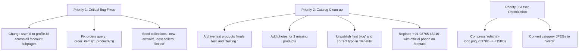

# Comprehensive Storefront & System Audit Report: Project Ruhvi

**Audit Date:** October 15, 2026  
**Audited Target:** `http://localhost:3000` (Production E-commerce Storefront)  
**Authenticated User:** `ruhvi.main@gmail.com` (Super Admin)  
**Stack:** Next.js 15.1 · React 19 · TypeScript · Tailwind CSS · Supabase · Firebase Auth  

---

## 1. Executive Summary

A comprehensive end-to-end technical, functional, content, and performance audit of the Ruhvi e-commerce web platform was conducted. While the application features a rich luxury aesthetic and functional core infrastructure (Next.js 15, Supabase Postgres, and Firebase Authentication), the audit uncovered:

1. **Critical 404 Links on Homepage & Footer:** Key hero call-to-action buttons link to collection slugs that do not exist in the database.
2. **Account Subpages Crash (Firebase UID vs. UUID Mismatch):** Several customer account subpages fail with Postgres type errors (`22P02: invalid input syntax for type uuid`) because the client queries database tables with `user.id` (Firebase alphanumeric UID string) instead of `profile.id` (Supabase UUID).
3. **Orders Page Crash (`/orders`):** Fatal PostgREST schema relationship error prevents the order history page from loading.
4. **Catalog & Content Anomalies:** Test products are published live on the storefront, multiple products lack images, and a draft blog post is publicly visible.
5. **Pending Third-Party Integrations:** Verified that **WhatsApp Business Cloud API** and **Shiprocket Logistics** are deliberately unconfigured and operating safely in mock/sandbox modes as requested.
6. **Performance & Asset Bottlenecks:** Multiple oversized uncompressed PNG/JPEG files reside in `public/` (notably `ruhchat-icon.png` at 537 KB).

---

## 2. Issues Summary Table

| Severity | Category | Issue Description | Impact | Target File(s) |
| :--- | :--- | :--- | :--- | :--- |
| **Critical** | Navigation / 404 | Homepage & Footer CTAs link to non-existent collection slugs (`/collections/new-arrivals`, `/collections/best-sellers`, `/collections/limited`) | Clicking primary hero/collection buttons immediately triggers 404 Not Found error | `src/app/page.tsx`<br>`src/components/layout/Footer.tsx` |
| **Critical** | Database / Auth | UUID Type Mismatch: `user.id` (Firebase UID string) is passed directly to Postgres UUID columns across `/account` subpages | Account subpages (`/account/coins`, `/account/addresses`, `/account/referrals`, `/account/returns`) fail with Postgres error `22P02: invalid input syntax for type uuid` | `src/app/account/coins/page.tsx`<br>`src/app/account/addresses/page.tsx`<br>`src/app/account/referrals/page.tsx`<br>`src/app/account/returns/page.tsx`<br>`src/app/account/page.tsx` |
| **Critical** | Orders Portal | Broken SQL relation in `src/app/orders/page.tsx`: queries `product(*)` instead of `products(*)` and uses Firebase UID | Order history page crashes on every fetch with PostgREST error `PGRST200` | `src/app/orders/page.tsx` |
| **High** | Catalog Integrity | 2 Test Products published on live storefront ("finale test", "Testing ") | Visible to customers, distorting catalog price filters and brand credibility | Supabase `products` table |
| **High** | Media Assets | 3 Live Products have 0 images; 2 Products share identical Unsplash stock photos | Products render blank/broken fallback images on catalog and detail pages | Supabase `product_images` table |
| **Medium** | Wallet Ledger | Discrepancy between `users.wallet_balance` (₹5,000) and `wallet_ledger` (1 entry: ₹50) | Top-up history does not balance with header/card balance | Supabase `wallet_ledger` table |
| **Medium** | Placeholders | Dummy phone `+91 98765 43210` on `/contact` and in root Schema JSON-LD; generic dummy address | Unprofessional contact touchpoints | `src/app/contact/page.tsx`<br>`src/app/layout.tsx` |
| **Medium** | Content / SEO | Typo in published blog article (`"Benifits of Gold Plated Jewellery"`); draft article `"test blog"` published live | Degrades search ranking and brand editorial quality | Supabase `blog_posts` table |
| **Medium** | Incomplete Pages | `/gift-guide` and `/offers` render hardcoded empty states rather than querying DB | Customers find dead ends instead of coupons or curated gifting collections | `src/app/gift-guide/GiftGuideClient.tsx`<br>`src/app/offers/OffersClient.tsx` |
| **Low** | Performance | Heavy uncompressed static images in `public/` (e.g. `ruhchat-icon.png` at 537 KB, `admin-login.png` at 279 KB) | Unnecessary bandwidth consumption and slower initial paint times | `public/ruhchat-icon.png`<br>`public/images/admin-login.png` |

---

## 3. Deep Dive Findings

### 3.1 Authentication & User Session Verification
* **Credentials Tested:** `ruhvi.main@gmail.com` / `S23081996s@`
* **Firebase Identity Status:** Valid & authenticated via Firebase Identity Toolkit REST API.
  * **Firebase UID:** `NhLqwDOJGoMFFh801UVF4x76CgI3`
  * **Email Verified:** `true`
  * **Phone Number:** `+918981782735` (Phone Verified: `true`)
* **Supabase User Profile:**
  * **User ID (UUID):** `2d0e30c6-37af-495b-b0b0-87f6bf552496`
  * **Role:** `super_admin` (All internal portals authorized: admin, operations, orders, support, tech, marketing)
  * **Referral Code:** `RHV-0C77C7`
* **Session Lifecycle:**
  * `POST /api/auth/session` successfully returns `200 OK` and sets the signed `__session` cookie.
  * `POST /api/auth/sync-token` successfully returns `200 OK` and produces a valid Supabase HS256 JWT for Row Level Security (RLS).

---

### 3.2 Wallet & Reward Coins Inspection

#### Wallet (`/account/wallet`):
* **Displayed Balance:** **₹5,000.00**
* **Underlying Database State (`wallet_ledger`):**
  * Contains only **1 record**:
    * `id`: `c6822be7-2541-4f65-9cd9-ba81d4c0fb53`
    * `amount`: ₹50.00 (`type: credit`, Sign-up bonus)
    * `created_at`: `2026-08-19`
* **Finding:** While the `users.wallet_balance` column stores ₹5,000.00, the ledger only tracks ₹50.00. The remaining ₹4,950.00 was modified directly without inserting audit records into `wallet_ledger`. As a result, the transaction history only displays one ₹50 item.

#### Reward Coins (`/account/coins`):
* **Coins Count:** `0` (Value: ₹0.00)
* **Critical Crash:** When navigating to `/account/coins`, the page queries:
  ```typescript
  supabase
    .from('reward_coin_ledger')
    .select('*')
    .eq('user_id', user.id); // user.id is the Firebase UID 'NhLqwDOJGoMFFh801UVF4x76CgI3'
  ```
  Postgres rejects this query with error code `22P02`:
  ```
  invalid input syntax for type uuid: "NhLqwDOJGoMFFh801UVF4x76CgI3"
  ```
  The ledger list fails to load for all authenticated customers. The query must use `profile?.id` (Supabase UUID).

---

### 3.3 Account Subpages & The Firebase UID Type Mismatch

In `src/context/AuthContext.tsx` line 220, `user.id` is assigned `fbUser.uid` (the 28-character Firebase alphanumeric string). The Supabase UUID is stored in `profile.id`.

The following pages incorrectly query Postgres using `user.id`, resulting in silent failure or error toasts:

1. **Saved Addresses (`/account/addresses`):**
   * Lines 88, 134, 142, 172, 184, 273, 291 query and insert using `.eq('user_id', user.id)`.
   * **Result:** Customers cannot view or add saved delivery addresses.
2. **Referral History (`/account/referrals`):**
   * Lines 26 and 37 query `.eq('referrer_user_id', user.id)` and `.eq('id', user.id)`.
   * **Result:** Referral tracking fails to load.
3. **Returns (`/account/returns`):**
   * Line 55 queries `.eq('order.user_id', user.id)`.
   * **Result:** Return requests fail to load.
4. **Profile Editing (`/account/page.tsx`):**
   * Line 208 queries `.eq('id', user.id)`.
   * **Result:** Name and profile updates fail to save.

---

### 3.4 Orders Page Fatal Error (`/orders`)

In `src/app/orders/page.tsx` lines 34-39:
```typescript
const { data, error } = await supabase
  .from('orders')
  .select('*, order_items(*, product(*))') // Error: Foreign relation is 'products', not 'product'
  .eq('user_id', user.id)                  // Error: 'user.id' is not a UUID
  .order('created_at', { ascending: false });
```
* **PostgREST Response:**
  ```json
  {
    "code": "PGRST200",
    "details": "Searched for a foreign key relationship between 'order_items' and 'product' in schema 'public', but no matches were found.",
    "hint": "Perhaps you meant 'products' instead of 'product'.",
    "message": "Could not find a relationship between 'order_items' and 'product' in the schema cache"
  }
  ```
* **Result:** The `/orders` page fails on every load.

---

### 3.5 Broken Collection Links (404 Not Found)

The database `collections` table only contains four slugs:
1. `for-her` ("Gifts For Her")
2. `under-15000` ("Gifts Under ₹15,000")
3. `anniversary` ("Anniversary Specials")
4. `bridal` ("Royal Bridal Collection")

However, the homepage and footer link to non-existent collection slugs:
* **Homepage Line 160:** `<Link href="/collections/new-arrivals">` ➔ **404 Not Found**
* **Homepage Line 200 & Footer Line 274:** `<Link href="/collections/best-sellers">` ➔ **404 Not Found**
* **Homepage Line 341:** `<Link href="/collections/limited">` ➔ **404 Not Found**
* **Footer Line 312:** `<Link href="/about#philosophy">` ➔ The `/about` page has no `#philosophy` HTML ID.

---

### 3.6 Store Catalog & Product Integrity

The database currently contains **9 products**:

| Product Name | Slug | Price | Status | Images in DB | Audit Observation |
| :--- | :--- | :--- | :--- | :--- | :--- |
| **finale test** | `finale-test` | ₹9,000 | active | 1 (Cloudinary) | **Internal test product** published live |
| **Testing ** | `testing` | ₹3,000 | active | 1 (Cloudinary) | **Internal test product** with trailing whitespace in title |
| **Aaranya Rose Gold Diamond Ring** | `aaranya-rose-gold-diamond-ring` | ₹34,999 | active | 1 (Cloudinary) | Production ready |
| **Royal Sapphire Drop Earrings** | `royal-sapphire-drop-earrings` | ₹18,500 | active | 1 (Unsplash) | Shares identical photo with Love chain |
| **Love chain** | `love-chain` | ₹2,900 | active | 1 (Unsplash) | Shares identical photo with Royal Sapphire |
| **Rose ring** | `rose-ring` | ₹12,000 | active | 2 (Cloudinary) | Production ready (2 image angles) |
| **Eternal Radiance Ring** | `eternal-radiance-ring` | ₹2,999 | active | **0 images** | Renders fallback placeholder box |
| **Moonlit Elegance Necklace** | `moonlit-elegance-necklace` | ₹5,999 | active | **0 images** | Highlighted as Best Seller on homepage, but has no photo |
| **Twilight Blooms Earrings** | `twilight-blooms-earrings` | ₹3,999 | active | **0 images** | Renders fallback placeholder box |

---

### 3.7 Placeholders & Incomplete Pages

1. **Contact Us (`/contact`):**
   * Displays dummy phone number: `+91 98765 43210`.
   * Displays generic dummy address: `Ruhvi Jewels, Mumbai, Maharashtra, India`.
2. **SEO Organization Schema (`src/app/layout.tsx` line 140):**
   * Hardcoded placeholder phone: `telephone: '+91-9876543210'`.
3. **Gift Guide (`/gift-guide`):**
   * Displays hardcoded empty state: *"No Gift Categories Available. Gift categories are being curated. Check back soon."*
   * It does not query existing gift collections (`for-her`, `under-15000`, `anniversary`) from the DB.
4. **Offers Page (`/offers`):**
   * Displays hardcoded empty state: *"No Public Coupons Right Now"* instead of querying active public coupons from the `coupons` table.
5. **Blog Editorial (`/blog`):**
   * Draft post titled `"test blog"` (`slug: test-blog`) is published live.
   * Typo in published title: `"Benifits of Gold Plated Jewellery"` (*Benifits* instead of *Benefits*).
6. **Orphaned Policies:**
   * `/cancellation-policy` and `/warranty-policy` are built under `src/app/(policies)/`, but are not linked in the footer.

---

### 3.8 Status of Deliberately Pending Integrations

#### WhatsApp Business Cloud API:
* **Code Location:** `src/lib/whatsapp.ts`
* **Status:** `WHATSAPP_ACCESS_TOKEN` and `WHATSAPP_PHONE_NUMBER_ID` are not configured in environment variables.
* **Current Behavior:** The client gracefully falls back to `[WhatsApp Sandbox]` console logging without throwing runtime errors. No messages are dispatched to real numbers.

#### Shiprocket Logistics:
* **Code Location:** `src/lib/shiprocket.ts` & `src/lib/shipping/shiprocket-provider.ts`
* **Status:** Production credentials are not active.
* **Current Behavior:** Token retrieval falls back to a stub token. Real AWB generation and order shipment dispatch are on standby awaiting account activation.

---

### 3.9 Performance & Image Optimization

#### Static Asset Audit (`public/`):
* Total files in `public/`: 21
* Files > 100 KB: 8
* Files > 500 KB: 1
* **Top Largest Files:**
  1. `public/ruhchat-icon.png`: **537 KB** (Excessive for a chat avatar; should be WebP/SVG under 15 KB).
  2. `public/images/admin-login.png`: **279 KB** (Uncompressed PNG).
  3. `public/images/logo.png`: **247 KB** (Redundant large logo file; `public/logo.png` is already 77 KB).
  4. Category fallback images (`public/images/categories/*.jpg`): `pendants.jpg` (132 KB), `bridal.jpg` (125 KB), `mens.jpg` (117 KB), `mangalsutra.jpg` (112 KB), `necklaces.jpg` (110 KB). None of these use modern WebP/AVIF compression.

#### Image Loading & Largest Contentful Paint (LCP):
* **Hero Section:** Properly implements high priority preloading:
  ```html
  <link rel="preload" as="image" href="..." fetchPriority="high" />
  ```
  Uses Cloudinary dynamic width transformations (`w_600`, `w_1000`, `w_1200`).
* **Category Cards & Collections:** Use fallback local JPEG paths without modern responsive `srcset`.

---

## 4. Remediation Plan



### Action Items

1. **Fix UUID Mapping in Account Pages:**
   * In `src/app/account/coins/page.tsx`, `src/app/account/addresses/page.tsx`, `src/app/account/referrals/page.tsx`, `src/app/account/returns/page.tsx`, and `src/app/account/page.tsx`, replace `user.id` with `profile?.id` for all Supabase queries and inserts.
2. **Fix Orders Query:**
   * In `src/app/orders/page.tsx`, update query from `order_items(*, product(*))` to `order_items(*, products(*))` and filter using `profile?.id`.
3. **Resolve Collection 404s:**
   * Seed the `collections` table with records for `new-arrivals`, `best-sellers`, and `limited`, OR update homepage and footer links to `/products?filter=...`.
4. **Clean Store Catalog:**
   * Archive or delete `finale-test` and `testing` products.
   * Upload images for `eternal-radiance-ring`, `moonlit-elegance-necklace`, and `twilight-blooms-earrings`.
5. **Clean Editorial & Contact Content:**
   * Unpublish `test-blog`.
   * Update `"Benifits"` to `"Benefits"` in the live blog post.
   * Replace dummy phone `+91 98765 43210` and generic address on `/contact` and in `layout.tsx`.
6. **Compress Static Media:**
   * Compress `public/ruhchat-icon.png` (537 KB) and convert to WebP.
   * Remove duplicate `public/images/logo.png` (247 KB) in favor of the optimized logo.
