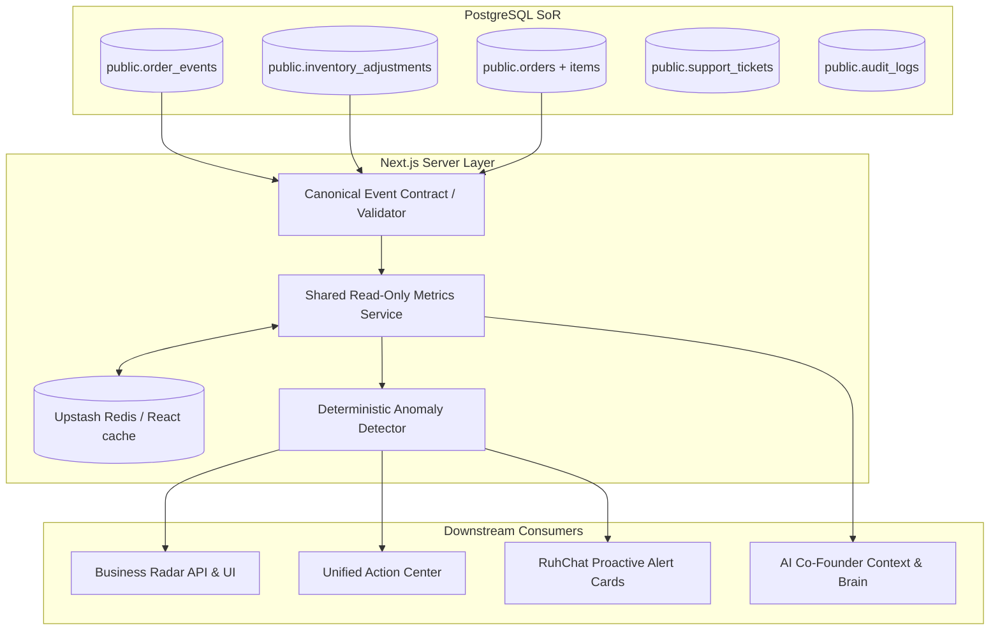

# Architecture Decision Record (ADR) 0001: Minimum-Change Intelligence Layer Architecture

**ADR Number:** ADR-0001  
**Title:** Minimum-Change Shared Intelligence Layer Architecture  
**Status:** PROPOSED (Awaiting User Explicit Approval at Phase 04 Gate)  
**Date:** 26 October 2026  
**Author:** AI Co-Architect / Antigravity IDE  
**Target Systems:** Next.js 15 App Router, Supabase PostgreSQL, Upstash Redis, PostHog  

---

## 1. Context & Business Need

Project Ruhvi has grown into a multi-portal e-commerce ecosystem (main storefront, admin panel, operations portal, orders portal, customer support, and AI Co-Founder workspace). While individual business features (order placement, inventory sync, ticket triage) function reliably, intelligence capabilities currently face three core challenges:

1. **Fragmented Calculation:** Financial and operational metrics are computed ad-hoc across multiple locations (`sales-metrics.ts`, `analytics.ts`, and direct SQL in page components).
2. **Missing Closed-Loop Gating:** AI Co-Founder and automated workers risk acting on unverified or hallucinated signals unless grounded in a single, typed, permission-checked intelligence layer.
3. **Budget and Reliability Safeguards:** The project must strictly comply with Vercel serverless execution limits, avoid introducing heavy external infrastructure (Kafka, ClickHouse, separate databases), and adhere to the **Strict Optimization Rules** preventing service duplication or breaking changes.

---

## 2. Decision Drivers

* **Zero New Vendor / Infrastructure Cost:** Must leverage already-funded, active stack components (Supabase PostgreSQL, Next.js Server Actions, Upstash Redis, PostHog, Vercel Crons, and self-hosted VM cron).
* **Zero Functional Breakage:** Cannot alter current checkout paths, PhonePe/Paytm webhooks, Firebase authentication, or customer portal routes.
* **Deterministic Numeric Grounding:** AI Co-Founder and business dashboards must derive metrics from verified transactional records, never from generative LLM numeric guesses.
* **Idempotency & Auditability:** Every business recommendation and consequential action must be reviewable, approved by authorized staff, and executed idempotently with append-only audit logging.
* **Sub-200ms Latency for Executive Views:** Aggregated metrics must be cached and bounded to eliminate expensive full-table scans.

---

## 3. Considered Alternatives

### Alternative 1: External Event Streaming & OLAP Warehouse (Kafka + ClickHouse / Snowflake)
* **Description:** Stream all operational events to an external message broker (Kafka/RabbitMQ) and ingest into an analytical column-store (ClickHouse) for real-time aggregation.
* **Why Rejected:**
  - Violates the rule against adding new databases or recurring paid vendor workloads.
  - Adds severe operational overhead, synchronization lag, and cross-system maintenance.
  - Ruhvi’s current transaction volume is fully within the high-performance throughput of Supabase PostgreSQL indexes and Redis caching.

### Alternative 2: Standalone Microservices Cluster
* **Description:** Spin up separate Node.js/Python microservices for anomaly detection and analytics computation.
* **Why Rejected:**
  - Introduces network hops, additional authentication layers, and increased cold-start latencies.
  - Redundant with existing Next.js App Router background routes and serverless execution model.

### Alternative 3: Zero-New-Infrastructure PostgreSQL Native Intelligence Pipeline (SELECTED)
* **Description:** Build the Shared Intelligence Layer directly on top of existing PostgreSQL tables (`public.order_events`, `public.inventory_adjustments`, `public.orders`, `public.co_founder_signals`, `public.co_founder_approvals`), utilizing Next.js typed Server Components, Redis/React `cache()`, and the established hybrid cron pipeline.
* **Why Selected:** Satisfies all requirements with **$0 new infrastructure cost**, leverages existing schema migrations (`0043`, `0102`, `0103`, `0104`), and guarantees transactional consistency.

---

## 4. Technical Architecture Blueprint

### 4.1 Component Breakdown & Data Ownership

| Component | Responsibility | Implementation Mechanism | Primary Files / DB Tables |
| :--- | :--- | :--- | :--- |
| **1. Typed Event Contract** | Enforce schema validation and correlation keys on all internal business events | Zod-validated TypeScript interfaces | `src/lib/intelligence/event-contract.ts` (Phase 07) |
| **2. Canonical Event Store** | Store immutable lifecycle event records | Existing PostgreSQL table with JSONB metadata | `public.order_events` (migration `0043`), `public.inventory_adjustments` (`0041`) |
| **3. Shared Metrics Service** | Single authoritative server interface calculating canonical KPIs (Gross/Net Sales, AOV, Cancellation, RTO, DOI) | Server-only module with TTL caching | `src/lib/intelligence/metrics-service.ts` (Phase 15) |
| **4. Layered Cache** | Prevent redundant DB aggregations; sub-100ms response | In-memory `cache()` for request-deduping + Upstash Redis (5-min TTL) | Upstash Redis (`src/lib/redis.ts`) |
| **5. Rule-Based Anomaly Engine** | Detect statistical deviations (spikes in payment failures, cancellation $\ge 15\%$, ticket backlog) | Deterministic algorithms with minimum sample sizes | `src/lib/intelligence/anomaly-detector.ts` (Phase 20) |
| **6. Recommendation & Approval Policy** | Manage proposed actions, expiration, risk tiers, and single-use execution tokens | Two-phase human-approval state machine | `public.co_founder_approvals` (migration `0104`), `src/lib/ai/co-founder/approvals.ts` |
| **7. Allowlisted Action Executor** | Safely execute approved low-risk actions with idempotency checks | Role-checked tool executor with audit logging | `src/lib/ai/co-founder/action-engine.ts` (Phase 30) |

---

## 5. Failure Handling, Idempotency & Replay Protection

1. **Replay & Webhook Idempotency:**
   - Every external webhook callback (PhonePe, Paytm, Shiprocket) and internal event processor MUST check idempotency keys before mutating database state or logging events.
   - Guarded via `checkActionIdempotency` in `src/lib/ai/co-founder/security.ts`.
2. **Graceful Degradation:**
   - If external integrations (e.g. Meta Ads API, Shiprocket) are offline, the metrics service returns `status: 'DATA_UNAVAILABLE'` with an explicit missing-source flag rather than failing or hallucinating zeroes.
3. **Read-Only Non-Blocking Scans:**
   - Background anomaly detection and telemetry jobs operate in read-only mode with strict execution timeouts (maximum 15 seconds) so failure in an analytical scan never impedes live storefront checkouts.

---

## 6. Retention & Data Lifecycle Policy

* **`public.order_events` & `public.inventory_adjustments`:** Retained indefinitely as permanent compliance and audit ledgers.
* **`public.ai_failure_diagnostics`:** Managed via TTL auto-expiration (migration `0026`), automatically cleaned up after 72 hours.
* **`public.co_founder_signals`:** Active signals expire after 7 days if unacknowledged, automatically transitioning to `superseded` or `expired`.
* **Aggregated Metrics Cache:** 5-minute rolling TTL in Redis.

---

## 7. Cost, Resource & Deployment Implications

* **New Infrastructure Cost:** **$0.00** (Zero additional monthly expenses).
* **Vercel Serverless Limits:** All metrics queries are bounded with strict `LIMIT` clauses and date filters (`Asia/Kolkata` bounds), executing within $< 250\text{ms}$ to stay well below Vercel's 10-second timeout.
* **Database Impact:** Employs existing B-Tree and GIN indexes created in migrations `0043`, `0073`, `0098`, and `0104`. No schema locks or table rebuilds required.

---

## 8. Acceptance Criteria for Phase 04

- [x] Evaluates existing tools before proposing new components.
- [x] Formally rejects unneeded heavy event buses and external OLAP databases.
- [x] Details concrete component owners, data flows, and failure handling.
- [x] Confirms zero recurring financial impact ($0.00).
- [x] Explicitly marked PROPOSED until formal user approval.
