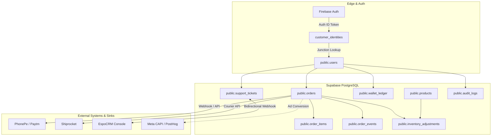

# Project Ruhvi — System-of-Record and Data-Ownership Map

**Document Version:** 1.0  
**Generated Date:** 26 October 2026  
**Status:** Authoritative Architectural Reference  
**Applicability:** Master Phased Implementation Plan — Phase 01 Deliverable  

---

## 1. Executive Summary & Core Architectural Principle

In Project Ruhvi, **Supabase PostgreSQL is the centralized, authoritative transactional System of Record (SoR)** for all persistent e-commerce business entities (products, stock, orders, line items, wallet ledger, tickets, audit logs, and internal tasks).

External integrations (Firebase Auth, PhonePe, Paytm, Shiprocket, EspoCRM, Cloudinary, PostHog, Meta CAPI, and Brevo) act either as **specialized edge identity/payment providers**, **downstream logistical executors**, or **event sinks**. No external service holds the master business truth for order fulfillment, wallet credits, or inventory balance.

---

## 2. Canonical Data Ownership Matrix

### 2.1 Products & SKUs
* **Authoritative Source of Truth:** `public.products` (PostgreSQL via Supabase).
* **Key Fields & Schema:**
  - `id` (UUID, Primary Key)
  - `sku` (TEXT, Unique, Master SKU code)
  - `name`, `slug` (Unique), `description`
  - `category_id` (UUID references `public.categories.id`)
  - `price` (Numeric 12,2 — active selling price including GST)
  - `mrp` (Numeric 12,2 — Maximum Retail Price)
  - `gst_rate` (Numeric 5,2 — default 3.00% for jewelry)
  - `status` (`product_status` ENUM: `active`, `hidden`, `out_of_stock`)
  - `is_new_arrival`, `is_best_seller` (Booleans)
* **Secondary / Media Storage:** `public.product_images` (UUID PK, `product_id`, `url`, `type`, `sort_order`). Image binaries reside in **Cloudinary Main Account**; image URLs and display sequence are strictly owned by Supabase.
* **Caches & Read Copies:**
  - Client-side React `useTaxonomy.ts` 5-minute memory cache.
  - Supabase taxonomy and metadata queries wrapped in Next.js React `cache()`.
* **Authoritative Mutation Path:** Operations Portal (`/operations/products`), Admin Panel (`/admin/products`), or server actions validating admin/manager roles.
* **Conflict / Drift Flags:** None. Product SKU uniqueness is enforced at database schema level (`UNIQUE(sku)`).

---

### 2.2 Stock & Inventory Adjustments
* **Authoritative Source of Truth:** `public.products.stock_quantity` mutated atomically via PostgreSQL function `public.adjust_product_stock` and audited in `public.inventory_adjustments`.
* **Key Fields & Schema:**
  - `products.stock_quantity` (Integer, Current sellable on-hand inventory).
  - `products.low_stock_threshold` (Integer, default 5).
  - `inventory_adjustments` (UUID PK, `product_id`, `user_id`, `previous_stock`, `adjusted_by`, `new_stock`, `reason` [`restock`, `damage`, `return`, `audit`, `transfer`, `manual`], `notes`, `created_at`).
  - Staging / Mobile Barcode Scan: `public.inventory_scan_staging` (migration `0112`) for batch barcode intake before committing to live stock.
* **Threshold Governance:** `settings.operations_thresholds` (migration `0073`) configuring `low_stock_multiplier`, `dead_stock_days`, etc.
* **Secondary / Read Copies:**
  - Catalog Intelligence cache (`src/lib/ai/co-founder/catalog-intelligence.ts`).
  - In-memory DOI (Days of Inventory) calculations.
* **Authoritative Mutation Path:**
  - On checkout confirmation: Atomic decrement during order finalization.
  - On return/restock: `public.adjust_product_stock` with row lock `FOR UPDATE`.
* **Conflict / Drift Flags:** Scan counts on mobile Expo app are **staging records only**; they must never directly override `products.stock_quantity` without verified RPC commit.

---

### 2.3 Customers, Authentication & Addresses
* **Authoritative Identity Provider (Auth):** **Firebase Auth** (handles credential security, Google OAuth, Phone OTP, Facebook Login, password resets).
* **Authoritative Business Profile (SoR):** `public.users` in Supabase Postgres.
* **Decoupling Junction:** `public.customer_identities` (migration `0030`, `0038`, `0071`).
  - Maps `firebase_uid` (Alphanumeric text) $\rightarrow$ `customer_id` (UUID matching `public.users.id`).
  - Supported providers: `password`, `phone`, `google.com`, `facebook.com`.
* **Key Fields & Schema:**
  - `users.id` (UUID PK)
  - `users.email`, `users.phone`, `users.full_name`
  - `users.role` (`user_role` ENUM: `customer`, `staff`, `manager`, `admin`, `super_admin`)
  - `users.wallet_balance` (Numeric 12,2)
  - `users.reward_coins` (Integer)
  - `users.is_vip`, `users.date_of_birth`, `users.is_dob_locked` (migration `0111`)
  - `users.totp_secret`, `users.totp_enabled` (AES-256-GCM encrypted, migration `0116`)
* **Customer Addresses:** `public.addresses` (UUID PK, `user_id`, `label`, `full_name`, `phone`, `line1`, `line2`, `city`, `state`, `pincode`, `is_default`).
* **Authoritative Mutation Path:** Edge API routes (`/api/auth/*`), canonical RPC `resolve_customer_identity`, and Admin User Management (`/admin/users`).
* **Conflict / Drift Flags:**
  - Firebase Auth holds user authentication credentials; Supabase `public.users` holds commercial and loyalty state.
  - Direct lookups matching `auth.uid() = users.id` are prohibited because Firebase UIDs are alphanumeric; all server-side user lookups must resolve through `customer_identities` or verify custom JWT `sub`.

---

### 2.4 Shopping Carts & Wishlists
* **Authoritative Source of Truth:** `public.carts` & `public.cart_items` in Supabase Postgres.
* **Key Fields & Schema:**
  - `carts.id` (UUID PK), `carts.user_id` (UUID Unique, 1-to-1 with `public.users.id`).
  - `cart_items` (UUID PK, `cart_id`, `product_id`, `quantity`, `price_at_add`, `created_at`).
  - `wishlists` (UUID PK, `user_id`, `product_id`, unique compound key).
* **Client Synchronization:** LocalStorage maintains guest cart temporarily; on user sign-in, guest cart items merge into `public.cart_items` via API `/api/cart/sync`.
* **Authoritative Mutation Path:** Storefront cart actions (`/api/cart/*`).
* **Conflict / Drift Flags:** Abandoned cart recovery cron queries `public.carts` joined with `public.cart_items` where `updated_at < now() - interval '24 hours'`.

---

### 2.5 Orders, Line Items & Timeline Events
* **Authoritative Source of Truth:** `public.orders`, `public.order_items`, and `public.order_events`.
* **Key Fields & Schema:**
  - `orders.id` (UUID PK), `orders.order_number` (Text Unique, e.g. `RUV-2026-XXXX`).
  - `orders.user_id` (UUID references `public.users.id`).
  - `orders.status` (`order_status` ENUM: `pending`, `confirmed`, `packing_started`, `packed`, `shipped`, `out_for_delivery`, `delivered`, `cancelled`, `returned`).
  - Financials: `subtotal`, `shipping_charge`, `cod_charge`, `coupon_discount`, `wallet_used`, `coins_redeemed`, `gst_amount`, `total`.
  - Payment attributes: `payment_method` (`phonepe`, `cod`, `paytm`), `payment_status` (`pending`, `paid`, `failed`, `refunded`), `is_partial_cod` (Boolean).
  - `order_items`: `order_id`, `product_id`, `sku`, `quantity`, `price_at_purchase`.
  - `order_events`: Immutable audit trail (`order_id`, `event_type`, `performed_by`, `portal`, `metadata`, `created_at`).
  - Call collision notes: `public.order_call_remarks` (`0114`).
* **Authoritative Mutation Path:**
  - Order Creation: `/api/checkout/*` invoking `create-order.ts`.
  - Order Finalization: Server-side webhook handlers (`finalize-phonepe-order.ts`, `/api/webhooks/phonepe`).
  - Status updates: Orders Portal (`orders.ruhvi.in`) logging corresponding `order_events`.
* **Conflict / Drift Flags:** Browser redirect return URLs cannot mark an order paid; only verified, cryptographic webhook callbacks or server-to-server payment status verification may transition `orders.payment_status` to `paid`.

---

### 2.6 Payments & Financial Transactions
* **Authoritative Source of Truth:**
  - Gateway Transaction Proof: PhonePe Merchant Webhook / Paytm Verification API.
  - Internal Commercial SoR: `public.orders.payment_status` & `public.wallet_ledger`.
* **Key Fields & Schema:**
  - `orders.payment_status`: `pending`, `paid`, `failed`, `refunded`.
  - Gateway Reference: Stored in order metadata / webhook audit payload (`merchant_transaction_id`, `provider_reference_id`).
  - Loyalty Wallet Ledger: `public.wallet_ledger` (UUID PK, `user_id`, `order_id`, `amount`, `type` [`credit`, `debit`, `cashback`]).
  - Reward Coins Ledger: `public.reward_coin_ledger` (UUID PK, `user_id`, `order_id`, `amount`, `type` [`earned`, `redeemed`, `expired`, `cashback`]).
* **Partial-COD Rule:** 10% advance pre-payment collected online via PhonePe/Paytm; remaining 90% balance collected by courier on delivery. Recorded with `is_partial_cod: true` and verified in `src/lib/orders/cod.ts`.
* **Conflict / Drift Flags:** Replay protection and idempotency keys must guard all payment webhook processors to eliminate duplicate ledger credits.

---

### 2.7 Shipping, Logistics & Returns
* **Authoritative Logistics Provider:** **Shiprocket API** (AWB generation, courier routing, shipment tracking).
* **Authoritative Internal SoR:** `public.orders` + `public.order_events` + `public.returns`.
* **Key Fields & Schema:**
  - `order_events.metadata`: `awb_code`, `courier_name`, `shipment_id`, `tracking_url`, `rto_reason`.
  - `public.returns`: UUID PK, `order_id`, `reason`, `status` (`requested`, `approved`, `rejected`, `completed`), `refund_method`, `requested_at`, `resolved_at`, defect image attachment (`0115`).
* **Authoritative Mutation Path:**
  - Courier dispatch: Orders Portal calling `/api/admin/shiprocket/create-order`.
  - Tracking status sync: Shiprocket incoming webhooks or scheduled sync crons updating `orders.status` and appending to `order_events`.
* **Conflict / Drift Flags:** Shiprocket holds transient courier tracking statuses, but Ruhvi's internal `public.order_events` is the binding legal record for customer order fulfillment and RTO liability.

---

### 2.8 Customer Support Cases & Helpdesk Sync
* **Authoritative Data SoR:** `public.support_tickets` & `public.support_ticket_messages` (Supabase).
* **Agent Operations Console:** **EspoCRM** (`crm.support.ruhvi.in` on self-hosted VPS).
* **Key Fields & Schema:**
  - `support_tickets.id` (UUID PK), `support_tickets.ticket_number` (e.g. `RUV-2026-000123`).
  - `customer_id`, `order_id`, `category_id`, `priority`, `status`, `sla_due_at`, `sla_breached`.
  - Espo Mapping Columns: `espo_case_id` (Text), `espo_synced_at`, `espo_last_sync_error` (migration `0062`).
  - Audit trail: `public.espo_sync_log`.
* **Authoritative Mutation Path:**
  - Customer Creation: Storefront AI GIA chat (`/api/support/chat`) or `/support/create-ticket`.
  - Agent Resolution: EspoCRM agent console syncing back to Supabase via HMAC-signed webhook (`/api/integrations/espo/webhook`).
* **Conflict / Drift Flags:** Supabase remains the primary source of truth for customer identity and order history. EspoCRM is an operational console for human agent collaboration.

---

### 2.9 Marketing Events, Ad Attribution & Campaigns
* **Authoritative Event Destinations:**
  - Behavioral Product Analytics: **PostHog** (session replay, funnel drop-off, page interactions).
  - Web Traffic & Aggregates: **Google Analytics 4 (GA4)**.
  - Conversion Tracking & Paid Ads: **Meta Pixel & Meta CAPI** (`/api/capi`).
  - Email Campaigns: **Brevo** (campaign statistics, subscriber lists, newsletter dispatch).
  - Transactional Push: **Firebase Cloud Messaging (FCM)** via `public.user_push_tokens` (`0070`).
* **Authoritative Promotional SoR (Database):**
  - Coupons: `public.coupons` (Code, discount type, min order value, limits, active).
  - Targeted Promotions: `public.promotions` (`0042`).
  - Push Campaigns: `public.push_campaigns` (`0022`, `0049`).
* **Conflict / Drift Flags:** Ad platforms (Meta, Google) report attribution models, but net sales and actual order conversion must strictly reconcile against `public.orders`.

---

### 2.10 AI Health, Model Routing & Telemetry
* **Authoritative Database Tables:**
  - Credentials & Weights: `public.ai_provider_credentials` (migration `0027`, AES-256-GCM encrypted keys).
  - Model Health & Latency: `public.ai_model_health` (`0027`, circuit breaker status, cooldowns, failover priorities).
  - Diagnostics with TTL: `public.ai_failure_diagnostics` (`0026`, auto-expiring error traces).
  - Request Logs: `public.ai_logs` (`0011`, `0028`, `0031`, token usage, latency ms, status).
  - Executive Signals & Approvals: `public.co_founder_signals` (`0103`), `public.co_founder_approvals` (`0104`), `public.co_founder_outcomes` (`0105`).
* **Telemetry Sinks:** **Sentry** (APM exceptions and MCP crashes), **OpenTelemetry** (`src/instrumentation-otel.ts`).
* **Conflict / Drift Flags:** AI credentials and circuit breakers live in PostgreSQL, not `.env`, allowing live rotation and zero-downtime failover between Gemini Account 1, Gemini Account 2, and DeepSeek.

---

### 2.11 Staff Operations, Task Management & Audit Logs
* **Authoritative Database Tables:**
  - Department Tasks: `public.tasks` (`0098_task_manager_schema.sql`).
  - Task Collaborators & History: `public.task_collaborators` (`0108`), `public.task_history` (`0098`).
  - System Security Audit Trail: `public.audit_logs` (`0020_audit_logs.sql`).
* **Authoritative Mutation Path:**
  - Task Manager API: `/api/task-manager/tasks/*`.
  - Audit logging: `logAuditEvent` helper in `src/lib/audit.ts`.
* **Conflict / Drift Flags:** `audit_logs` is append-only; row deletion or modification is blocked by RLS policies.

---

## 3. Data Flow & Boundary Summary

| Entity Group | Source of Truth (SoR) | Primary Storage | Replicas / Caches | External Integration |
| :--- | :--- | :--- | :--- | :--- |
| **Catalog & Products** | Supabase Postgres | `public.products` | React `cache()`, 5-min client cache | Cloudinary (Image binary only) |
| **Stock & Inventory** | Supabase Postgres | `public.products.stock_quantity` | In-memory DOI models | Expo Mobile (Staging only) |
| **User Identity & Auth** | Firebase Auth + Supabase | `customer_identities` $\rightarrow$ `users` | Session JWT cookie (`__session`) | Google OAuth, Phone OTP, Facebook |
| **Orders & Fulfillment** | Supabase Postgres | `public.orders`, `order_items` | Read views in portal | Shiprocket (Logistics tracking) |
| **Payments** | Gateway Proof + Supabase | `public.orders.payment_status` | Webhook verification logs | PhonePe, Paytm |
| **Customer Support** | Supabase Postgres | `public.support_tickets` | EspoCRM VPS (`crm.support.ruhvi.in`) | EspoCRM Agent Console |
| **Product Analytics** | PostHog | PostHog Cloud | Client-side tracking buffer | Meta CAPI, Google Analytics 4 |
| **AI Credentials & Logs** | Supabase Postgres | `public.ai_provider_credentials` | Circuit breaker in-memory state | Gemini, DeepSeek, Sentry |
| **Tasks & Audit Logs** | Supabase Postgres | `public.tasks`, `public.audit_logs` | Realtime channel updates | Internal Staff Chat |

---

## 4. Unresolved Ambiguities & Recommended Standardizations

1. **Sales Metric Convergence:** Ensure all administrative analytics (Sales Dashboard, Overview Dashboard, AI Co-Founder Analytics) query a canonical database RPC/view derived directly from `public.orders` and `public.order_items` with identical status filters (`status NOT IN ('cancelled', 'returned')`).
2. **Guest Identity Consolidation:** Continue enforcing `0038_fix_resolve_customer_identity.sql` so guest order checkouts via phone or email cleanly reconcile under a single `customer_identities` record when the user formally signs in.
