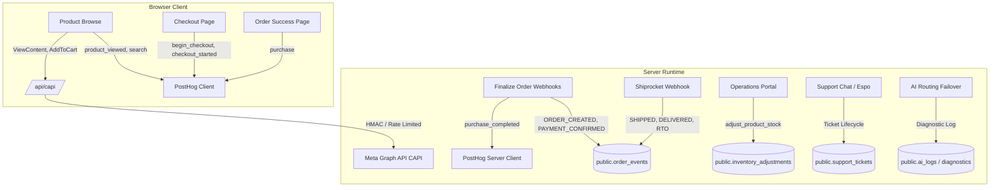

# Project Ruhvi — Traceable Event Coverage & Tracking Map

**Document Version:** 1.0  
**Generated Date:** 26 October 2026  
**Status:** Authoritative Architectural Audit Reference  
**Applicability:** Master Phased Implementation Plan — Phase 03 Deliverable  

---

## 1. Executive Summary & Event Routing Architecture

Project Ruhvi utilizes a hybrid client-and-server event tracking architecture divided into three operational tiers:
1. **Behavioral & Storefront Analytics:** PostHog (and legacy GA4 wrappers) for user journey funnels and drop-off analysis.
2. **Paid Advertising Attribution:** Meta Pixel (client) and Meta Conversions API (CAPI via `/api/capi`) for ad campaign optimization.
3. **Internal Transactional & Operational Event Log:** PostgreSQL `public.order_events`, `public.inventory_adjustments`, `public.support_tickets`, `public.audit_logs`, and `public.ai_logs`.

---

## 2. Complete Event Inventory

### 2.1 Storefront Discovery & Browsing

| Event Name | Trigger Condition | Source | Destination | Identifiers | Payload Fields | Status | Test Coverage |
| :--- | :--- | :--- | :--- | :--- | :--- | :--- | :--- |
| **`$pageview`** | Route transition | Client Router (`gtag.ts:18`) | PostHog | Anonymous ID / PostHog cookie | `$current_url` | **Active & Verified** | Manual / E2E |
| **`search`** | Submitting search in search bar | Client component (`SearchBar.tsx:129`) | PostHog (via `ecommerceEvent`) | PostHog distinctId | `search_term` | **Active & Verified** | Tested in component |
| **`product_viewed`** | PDP mounts (`/products/[slug]`) | Client component (`ProductDetailPageClient.tsx:105`) | PostHog | PostHog distinctId | `product_id`, `name`, `price`, `category` | **Active & Verified** | Unit / Mock |
| **`ViewContent`** | PDP mounts (`/products/[slug]`) | Client component (`ProductDetailPageClient.tsx:82`) | Meta Pixel & Meta CAPI | `_fbp`, `_fbc`, IP, UserAgent | `content_name`, `content_ids`, `content_type: 'product'`, `value`, `currency: 'INR'` | **Active & Verified** | Verified in CAPI route |
| **`product_added_to_wishlist`** | Customer clicks heart icon | Context (`WishlistContext.tsx:57`) | PostHog (via `ecommerceEvent`) | PostHog distinctId | `product_id`, `name` | **Active & Verified** | Context unit test |

---

### 2.2 Shopping Funnel & Intent

| Event Name | Trigger Condition | Source | Destination | Identifiers | Payload Fields | Status | Test Coverage |
| :--- | :--- | :--- | :--- | :--- | :--- | :--- | :--- |
| **`AddToCart` (Meta)** | Click "Add to Cart" on product card or PDP | Client component (`ProductCard.tsx:31`, `ProductDetailPageClient.tsx:152`) | Meta Pixel & Meta CAPI | `_fbp`, `_fbc`, IP, UserAgent | `content_name`, `content_ids`, `value`, `currency: 'INR'` | **Active & Verified** | Tested |
| **`add_to_cart` (PostHog)** | Click "Add to Cart" | Client | PostHog | DistinctId | `product_id`, `name`, `price`, `quantity` | ⚠️ **MISSING GAP**: `ProductCard.tsx` does NOT dispatch to PostHog, only to Meta CAPI. | No PostHog coverage |
| **`begin_checkout`** | Checkout page mounts with items | Client (`checkout/page.tsx:158`) | PostHog (via `gtag.ts`) | PostHog distinctId | `currency: 'INR'`, `value: subtotal`, `items: [...]` | ⚠️ **DUPLICATE RISK**: Fires simultaneously with `checkout_started`. | Untested |
| **`checkout_started`** | Checkout page mounts with items | Client (`checkout/page.tsx:169`) | PostHog direct | PostHog distinctId | `cart_value`, `item_count` | ⚠️ **DUPLICATE RISK**: Second event for same user action. | Untested |

---

### 2.3 Order Confirmation & Payment Settlement

| Event Name | Trigger Condition | Source | Destination | Identifiers | Payload Fields | Status | Test Coverage |
| :--- | :--- | :--- | :--- | :--- | :--- | :--- | :--- |
| **`ORDER_CREATED`** | Order inserted into DB as pending | Server API (`src/lib/orders/create-order.ts`) | `public.order_events` (PostgreSQL) | `order_id`, `user_id` | `portal: 'storefront'`, `order_number`, `total`, `items` | **Active & Verified** | `order.service.test.ts` |
| **`PAYMENT_CONFIRMED`** | Payment webhook verifies settlement | Server webhook (`finalize-phonepe-order.ts`, `finalize-paytm-order.ts`) | `public.order_events` (PostgreSQL) | `order_id`, `performed_by: NULL (System)` | `merchant_transaction_id`, `gateway`, `amount`, `payment_mode` | **Active & Verified** | `status-engine.test.ts` |
| **`purchase_completed`** | Order marked paid in DB | Server action (`finalize-phonepe-order.ts:100`, `finalize-paytm-order.ts:92`) | PostHog (via server client `PostHogClient`) | `distinctId: order.user_id \|\| order.id` | `revenue`, `currency: 'INR'`, `order_id: order.order_number`, `product`, `coupon` | **Active & Verified** (Server-Side) | Status engine tests |
| **`purchase`** | Order confirmation page mounts | Client component (`order-success/[orderId]/page.tsx:55`) | PostHog (via `gtag.ts`) | PostHog distinctId | `transaction_id`, `currency: 'INR'`, `value: order.total`, `items: [...]` | ⚠️ **EVENT NAME MISMATCH**: Client sends `purchase`; server sends `purchase_completed`. | Manual only |
| **`Purchase` (Meta)** | Successful order conversion | Server / Client | Meta Pixel / CAPI | `_fbp`, `_fbc`, Order ID, User details | `value`, `currency`, `content_ids`, `num_items` | ⚠️ **CRITICAL GAP**: Neither client `order-success` nor server finalization calls `/api/capi` with `Purchase`. Ad ROAS tracking is blind. | None |

---

### 2.4 Logistics & Order Lifecycle Events (`public.order_events`)

All events below are authoritative server-side transactional events logged to PostgreSQL `public.order_events` via `src/lib/order-events.ts:logOrderEvent` (migration `0043`):

| Event Type | Trigger Origin | Trigger Condition | Destination | Metadata Captured | Status |
| :--- | :--- | :--- | :--- | :--- | :--- |
| **`ORDER_CONFIRMED`** | Orders Portal (`orders.ruhvi.in`) | Staff confirms COD or custom order | `public.order_events` | `confirmed_by`, `notes` | **Active & Verified** |
| **`PACKING_STARTED`** | Orders Portal | Warehouse staff begins packing | `public.order_events` | `packing_location`, `staff_id` | **Active & Verified** |
| **`PACKED`** | Orders Portal | Item packaged into branded jewelry box | `public.order_events` | `box_id`, `weight_grams` | **Active & Verified** |
| **`LABEL_CREATED`** | Shiprocket integration | Shipping label & barcode generated | `public.order_events` | `shipment_id`, `label_url` | **Active & Verified** |
| **`MANIFEST_CREATED`** | Shiprocket integration | Manifest assigned for courier pickup | `public.order_events` | `manifest_id`, `courier_name` | **Active & Verified** |
| **`SHIPPED`** | Shiprocket webhook / staff | Handed over to courier | `public.order_events` | `awb_code`, `courier_name`, `tracking_url` | **Active & Verified** |
| **`OUT_FOR_DELIVERY`** | Shiprocket webhook | Courier out for final delivery | `public.order_events` | `awb_code`, `expected_time` | **Active & Verified** |
| **`DELIVERED`** | Shiprocket webhook | Delivered to recipient | `public.order_events` | `delivered_at`, `signed_by` | **Active & Verified** |
| **`RETURN_REQUESTED`** | Customer / Support Chat | Customer requests return/exchange | `public.order_events` & `public.returns` | `reason`, `refund_method`, `defect_url` | **Active & Verified** |
| **`RETURN_APPROVED`** | Support / Orders staff | Return claim approved by staff | `public.order_events` & `public.returns` | `approved_by`, `instructions` | **Active & Verified** |
| **`RETURN_PICKED`** | Shiprocket reverse courier | Courier picks up item from customer | `public.order_events` | `reverse_awb` | **Active & Verified** |
| **`REFUND_INITIATED`** | Admin / Finance portal | Refund credited to wallet / source | `public.order_events` & `public.wallet_ledger` | `refund_amount`, `refund_method` | **Active & Verified** |
| **`RTO_INITIATED`** | Shiprocket webhook | Courier marks delivery failed / RTO | `public.order_events` | `rto_reason`, `awb_code` | **Active & Verified** |
| **`RTO_RECEIVED`** | Warehouse staff | Returned parcel received at warehouse | `public.order_events` & `public.inventory_adjustments` | `restocked: boolean`, `condition` | **Active & Verified** |
| **`CANCELLED`** | Customer / Admin | Order cancelled prior to dispatch | `public.order_events` & `public.orders` | `cancellation_reason`, `cancelled_by` | **Active & Verified** |

---

### 2.5 Inventory Mutations (`public.inventory_adjustments`)

All stock mutations pass through atomic PostgreSQL function `adjust_product_stock` (migration `0041`), generating an immutable record in `public.inventory_adjustments`:

| Adjustment Reason | Trigger Origin | Trigger Condition | Fields Stored |
| :--- | :--- | :--- | :--- |
| **`restock`** | Operations Portal / Supplier Intake | New inventory received from manufacturer | `product_id`, `user_id`, `previous_stock`, `adjusted_by (+N)`, `new_stock`, `notes` |
| **`damage`** | Quality Check / Warehouse | Defective or damaged jewelry written off | `product_id`, `user_id`, `previous_stock`, `adjusted_by (-N)`, `new_stock`, `notes` |
| **`return`** | Orders Portal (Return/RTO) | Undelivered or returned product inspected and returned to sellable stock | `product_id`, `user_id`, `previous_stock`, `adjusted_by (+1)`, `new_stock`, `notes` |
| **`audit`** | Periodic Physical Inventory Audit | Cycle count reconciliation | `product_id`, `user_id`, `previous_stock`, `adjusted_by (delta)`, `new_stock`, `notes` |
| **`transfer`** | Warehouse Management | Relocation between stock bins | `product_id`, `user_id`, `previous_stock`, `adjusted_by`, `new_stock`, `notes` |
| **`manual`** | Super Admin Correction | Administrative stock override | `product_id`, `user_id`, `previous_stock`, `adjusted_by`, `new_stock`, `notes` |

---

### 2.6 Customer Support & CRM Activity

| Event Name | Source | Destination | Identifiers | Data Captured |
| :--- | :--- | :--- | :--- | :--- |
| **Ticket Opened** | AI Concierge (`/api/support/chat`) or `/support/create-ticket` | `public.support_tickets` | `ticket_number`, `customer_id` | `title`, `description`, `priority`, `category_id`, `sla_due_at` |
| **Message Sent** | Customer / Agent / GIA | `public.support_ticket_messages` | `ticket_id`, `sender_id` | `message_text`, `is_internal_note`, `sender_type` |
| **EspoCRM Case Sync** | Background webhook | `crm.support.ruhvi.in` & `public.espo_sync_log` | `espo_case_id`, `ticket_id` | `direction: 'outbound'\|'inbound'`, `action`, `status` |
| **Ticket Status Change** | Agent Console / Support Portal | `public.support_tickets.status` | `ticket_id`, `assigned_to` | New status (`open`, `in_progress`, `resolved`, `closed`), `resolved_at` |

---

### 2.7 AI Health & Reliability Telemetry

| Telemetry Event | Source | Destination | Captured Attributes |
| :--- | :--- | :--- | :--- |
| **AI Request Completed** | `src/lib/ai/index.ts` | `public.ai_logs` (`0011`, `0028`) | `credential_id`, `provider`, `model`, `latency_ms`, `tokens_used`, `status: 'success'` |
| **AI Rate Limit / Outage** | Multi-credential router | `public.ai_failure_diagnostics` (`0026`) | `feature`, `primary_provider`, `failed_provider`, `fallback_provider`, `error_type`, `ttl` |
| **Proactive Alert Dispatch** | Autonomous 15-min cron (`/api/cron/task-scheduler`) | RuhChat (`internal_chat_conversations`) via `/api/internal-chat/proactive-dispatch` | Department channel, markdown card, masked PII, direct portal URL |
| **Server / MCP Exception** | Serverless route handlers | **Sentry** (`@sentry/nextjs`) | Stack trace, route context, HTTP status code (PII stripped) |

---

## 3. Discovered Gaps, Redundancies & Contradictions

### 3.1 Critical Tracking Gaps
1. **Missing Meta CAPI `Purchase` Event:** While `ViewContent` and `AddToCart` are dispatched to `/api/capi`, completed purchases are NEVER transmitted to Meta CAPI. As a result, Meta Ads algorithm cannot optimize for ROAS or customer acquisition.
2. **Missing PostHog `add_to_cart` in ProductCard:** When a customer clicks "Add to Cart" directly from the category grid or search listing (`ProductCard.tsx:31`), the event is dispatched to Meta CAPI but omitted from PostHog, causing undercounted cart additions in PostHog funnel analysis.

### 3.2 Duplicate Firing & Redundancies
1. **Checkout Started Duplication (`checkout/page.tsx`):**
   - Line 158 fires `ecommerceEvent('begin_checkout')` (which calls PostHog).
   - Line 169 fires `ph.capture('checkout_started')`.
   - **Impact:** PostHog registers two distinct events for a single user entering checkout.
2. **Purchase Event Discrepancy:**
   - Server-side finalization fires `purchase_completed` (`distinctId = order.user_id`).
   - Client-side success page fires `purchase` (`distinctId = PostHog anonymous ID`).
   - **Impact:** Analytics queries querying `purchase` miss server-confirmed COD orders; queries querying `purchase_completed` miss client-only context.

### 3.3 Privacy & Data Minimization Guard
* Customer PII (phone number, full address, email) is properly excluded from PostHog event payloads.
* Meta CAPI encrypts/hashes user data via HTTPS POST with sliding-window rate limiting (60 req/min).
* AI logs in `public.ai_logs` record token counts and latency, but exclude customer query bodies and prompt contents.
