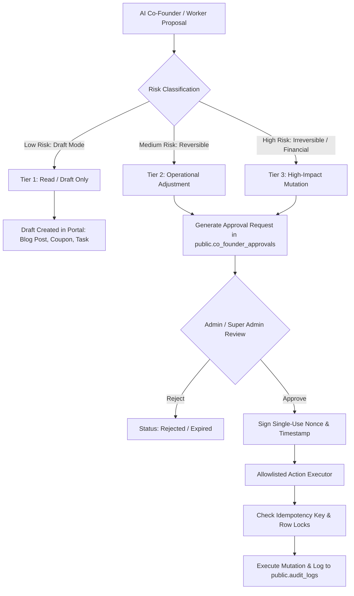

# Project Ruhvi — Privacy, Authorization & Action-Safety Model

**Document Version:** 1.0  
**Generated Date:** 26 October 2026  
**Status:** Authoritative Security & Governance Specification  
**Applicability:** Master Phased Implementation Plan — Phase 05 Deliverable  

---

## 1. Executive Summary & Security Philosophy

The **Shared Intelligence Layer and AI Co-Founder** operate under a strict **Least-Privilege, Fail-Closed, Human-in-the-Loop** governance architecture:
1. **Zero Raw PII Exposure to External LLMs:** Customer identities, delivery street addresses, phone numbers, and payment details are strictly redacted or masked before being evaluated by artificial intelligence models.
2. **Departmental Secrecy Firewalls:** Operational staff (Logistics, Support, Operations) can access only the domain data required to fulfill customer requests; gross revenue, profit margins, and platform credentials are restricted to Administrators and Executives.
3. **Deterministic Human-Approval Gate:** No autonomous worker or AI agent possesses unilateral authority to mutate live inventory, alter public selling prices, issue customer refunds, or dispatch mass marketing broadcasts without explicit administrative approval.

---

## 2. Role-Based Access Control (RBAC) & Permission Matrix

The table below defines the authorization boundaries for all proposed intelligence capabilities across Project Ruhvi’s 5 standard roles:

| Capability / Data Surface | Customer | Department Staff | Department Manager | Administrator (`admin`) | Super Admin (`super_admin`) |
| :--- | :--- | :--- | :--- | :--- | :--- |
| **Storefront Funnel & Self Context** | Self Only (RLS) | Blocked | Blocked | View All | View All |
| **Aggregate Store Metrics (Gross/Net Sales, AOV)** | Blocked | Blocked | Department KPIs only | Full Access | Full Access |
| **Financial Margins & Platform Profitability** | Blocked | Blocked | Blocked | Read-Only | Full Access |
| **Customer PII (Phone, Full Address)** | Self Only | **Masked Only** (`+91 98301 ••••82`) | Masked Only | Unmasked (Audit Logged) | Unmasked (Audit Logged) |
| **Customer Support Ticket Management** | Self Tickets | Assigned Department | Department Queue | Full Access | Full Access |
| **Inventory Levels & Stock-out Risk** | Stock Status Only | Operations / Logistics | Operations / Logistics | Full Access | Full Access |
| **Business Radar & Anomaly Review** | Blocked | Blocked | Department Radar | Full Access | Full Access |
| **AI Co-Founder Chat & Strategic Advisor** | Blocked | Blocked | Blocked | Super Admin / Founder Only | Super Admin / Founder Only |
| **Department AI Co-Workers (RuhChat)** | Blocked | Allowed (Scoped tools) | Allowed (Scoped tools) | Full Access | Full Access |
| **Approve AI High-Impact Actions** | Blocked | Blocked | Blocked | **Authorized** | **Authorized** |
| **Staff Productivity & System Audit Logs** | Blocked | Blocked | Department Staff Only | Full Access | Full Access |
| **System Diagnostics & AI Provider Credentials** | Blocked | Blocked | Blocked | Tech Admin (Masked keys) | Full Access (Encrypted at rest) |

---

## 3. Data-Minimization & External LLM Redaction Contract

All AI features (GIA customer shopping concierge, department AI workers, AI Co-Founder brain, and decision simulators) MUST pass prompt context through the centralized sanitization pipeline (`src/lib/ai/co-founder/security.ts` and `src/app/api/support/chat/route.ts`).

### 3.1 Prohibited Data (Must NEVER Reach an External LLM)
Under no circumstances may any prompt sent to Google Gemini, DeepSeek, or third-party inference providers contain:
1. **Cryptographic Secrets & Credentials:**
   - Database service keys (`SUPABASE_SERVICE_ROLE_KEY`), JWT secret (`SUPABASE_JWT_SECRET`), encryption salts (`CREDENTIAL_ENCRYPTION_KEY`).
   - Third-party API keys (Resend, Brevo, PhonePe, Paytm, Shiprocket, Cloudinary).
   - Staff TOTP 2FA secret seeds (`users.totp_secret`) or recovery codes.
2. **Payment & Banking Data:**
   - Full credit/debit card numbers, CVVs, expiry dates.
   - Bank account numbers, IFSC codes, UPI PINs.
   - Indian Government Identifiers (Aadhaar, PAN).
3. **Internal System Paths & Database DDL:**
   - Raw SQL queries, uncompiled migrations, internal file paths (`c:\Users\...`).
4. **Unconsented Personal Identifiers:**
   - Customer full home addresses, full phone numbers, raw email passwords.

### 3.2 Redaction & Masking Rules

| Data Type | Raw Format | Masked Format for Intelligence Layer & Staff Views | Implementation Guard |
| :--- | :--- | :--- | :--- |
| **Customer Phone** | `+919830123482` | `+91 98301 ••••82` | `maskPhoneNumber()` in `security.ts` |
| **Customer Name** | `Subhas Chandra Das` | `Subhas D.` or `S***** D**` | `maskCustomerName()` |
| **Delivery Address** | `12/A Diamond Harbor Rd, Kolkata 700034` | `Kolkata, WB (PIN: 700034)` | Strip street number & premises |
| **Payment Reference** | `T241026194218392189` | Gateway Name + Last 4 (`PhonePe ••••2189`) | Transaction metadata filter |
| **Revenue in Staff Chat** | `Gross Revenue: ₹14,25,000` | Excluded (`[RESTRICTED_METRIC]`) | Worker Firewall Policy |

---

## 4. Action-Safety Policy & Human-in-the-Loop Gating

### 4.1 Risk Classification of Proposed Actions

All actions generated by the AI Co-Founder or automated intelligence detectors are strictly classified into three risk tiers:

| Tier | Risk Level | Example Actions | Approval Requirement | Execution Boundary |
| :--- | :--- | :--- | :--- | :--- |
| **Tier 1** | **Low (Draft Only)** | Generate blog draft, draft promotional offer, create internal staff task, suggest restock list | **Automated Draft** | Staged in draft state; staff must manually publish or confirm. |
| **Tier 2** | **Medium (Reversible)** | Apply category banner, update low-stock alert threshold, acknowledge anomaly signal | **Single Staff Approval** | Manager or Admin approval token required; expires after 24 hours. |
| **Tier 3** | **High (Financial / Irreversible)** | Activate flash-sale coupon, change live product price, adjust live stock count, dispatch push campaign | **Super Admin Explicit Approval** | Dual-key authorization (Super Admin session + single-use signed approval token); immutable audit log. |

### 4.2 Explicitly Prohibited Actions (Autonomous Hard Blocks)
The following operations are **permanently barred from programmatic execution** by any AI model, worker, or automated agent:
1. **No Autonomous Database Deletions:** Executing SQL `DROP`, `TRUNCATE`, or batch `DELETE` on products, users, or orders.
2. **No Autonomous Financial Transfers:** Automatically dispatching payments, issuing bank refunds, or altering payment gateway credentials.
3. **No Unattended Mass Outbound Blasts:** Sending mass marketing WhatsApp, SMS, or email broadcasts without human preview and click-to-send.
4. **No Autonomous Production Deployments:** Triggering production Vercel deployments, modifying Cloudflare DNS records, or rotating live SSL certificates.
5. **No Blind Role Escalation:** Modifying a user's role to `admin` or `super_admin` without 2FA re-verification by an existing Super Admin.

---

## 5. Verification & Security Baseline

1. **Edge Middleware Enforcement:**
   - Every request to `/admin/*`, `/operations/*`, `/orders/*`, and `/support/*` is validated in `src/middleware.ts` against the user's role and verified TOTP 2FA claim (`mfa_verified: true`).
2. **Action Engine Security:**
   - `src/lib/ai/co-founder/action-engine.ts` validates that every high-impact execution payload matches the exact cryptographically signed `approvalId` and re-verifies user scopes server-side via `assertToolPermission`.
3. **Idempotency Guarantee:**
   - Execution tokens are single-use; subsequent execution attempts with the same token are rejected with `409 Conflict`.
