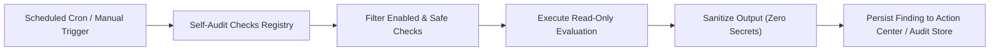

# Ruhvi Self-Auditing Architecture — Canonical Checks Registry

**Document:** `SELF_AUDIT_CHECKS_REGISTRY.md`  
**Track:** Track J — Self-Auditing Architecture (Phase 47)  
**Status:** Approved & Implemented  
**Date:** 2026-10-27  

---

## 1. Overview & Architectural Purpose

The **Ruhvi Self-Auditing Architecture** transforms the e-commerce platform into a resilient, self-inspecting operating system. Rather than relying solely on external uptime monitors or reactive customer support tickets, Ruhvi executes scheduled, strictly read-only diagnostics across six core operational dimensions:

1. **Architecture & Routing (`architecture`)**: Verifies App Router structures, build bundles, and module integrity.
2. **Third-Party Integrations (`integration`)**: Tests connectivity, response latencies, and credential health for databases, authentication, couriers, and payment gateways.
3. **Configuration & Secrets Hygiene (`configuration`)**: Audits runtime environment variable presence without exposing private key secrets.
4. **Security & Authorization (`security`)**: Verifies RBAC route boundaries, webhook signature verifications, and customer PII isolation.
5. **System Performance (`performance`)**: Monitors API latency budgets and circuit breaker telemetry.
6. **AI Intelligence Engine (`ai_health`)**: Verifies anomaly detection rules, decision simulator fixtures, and AI provider failover readiness.

---

## 2. Mandatory Safety & Non-Destructive Invariants

To eliminate any risk of production disruption or data corruption, all registered audit checks must adhere to four immutable invariants:

1. **Strictly Read-Only (`isDestructive === false`)**:
   - Checks are strictly passive inspections or synthetic read-only queries.
   - No check may insert, update, or delete customer orders, catalog products, or wallet balances.
   - No check may mutate production settings, rotate API keys, or deploy code.
2. **Zero Secret Exposure (`Secret Hygiene`)**:
   - Checks verify the *existence*, *format*, or *length* of secrets/keys, but NEVER log, print, or serialize plaintext secret values in audit results.
3. **Safe Execution Limits & Timeouts**:
   - Every check specifies a bounded timeout (`timeoutMs`, typically 2000ms–5000ms) to prevent hanging worker threads or serverless timeouts.
4. **Resilient Failure Isolation**:
   - If a third-party service is unreachable or errors during inspection, the check yields a structured `FAIL` or `WARN` result with actionable remediation hints; it never throws an uncaught exception that crashes the server.

---

## 3. Registered Audit Checks Matrix

| Check ID | Name | Category | Severity | Execution Mode | Evidence Source | Expected Result | Limitations |
| :--- | :--- | :--- | :--- | :--- | :--- | :--- | :--- |
| `chk_arch_app_router_routes` | App Router Route Integrity | Architecture | HIGH | Passive Inspection | Route Manifest | Critical routes (`/`, `/checkout`, `/admin/*`) present | Does not verify dynamic runtime param rendering |
| `chk_arch_package_dependencies` | Dependency Manifest Integrity | Architecture | MEDIUM | Passive Inspection | `package.json` | Core packages meet Next.js 15 compatibility | Does not execute remote npm audit |
| `chk_int_supabase_connection` | Supabase Postgres Connectivity | Integration | CRITICAL | Read-only Synthetic | Supabase Client | Healthy DB response time (< 500ms) | Read-only ping; does not test heavy analytical locks |
| `chk_int_firebase_auth_rest` | Firebase Auth REST Service | Integration | CRITICAL | Read-only Synthetic | Identity Toolkit | REST endpoint reachable (< 400ms) | Does not initiate live phone SMS OTP dispatch |
| `chk_int_cloudinary_access` | Cloudinary Storage & CDN | Integration | HIGH | Read-only Synthetic | Cloudinary CDN | Asset CDN responds with HTTP 200/304 | Does not upload test media assets |
| `chk_int_transactional_email_provider` | Resend / Brevo Email Provider | Integration | HIGH | Passive Inspection | Provider Config | API credentials & sending domain configured | Does not dispatch live emails to customers |
| `chk_int_shiprocket_logistics` | Shiprocket Logistics API | Integration | HIGH | Passive Inspection | Shiprocket Config | Courier API credentials & token configured | Does not create live AWB or dispatch pickups |
| `chk_int_payment_gateway_config` | Payment Gateway Config | Integration | CRITICAL | Passive Inspection | Gateway Secrets | PhonePe & Paytm merchant IDs & keys present | Does not initiate test payment transactions |
| `chk_cfg_required_env_presence` | Runtime Environment Audit | Configuration | CRITICAL | Passive Inspection | `process.env` | All mandatory production env variables set | Checks presence only; does not log secrets |
| `chk_cfg_public_secret_hygiene` | Client Secret Leakage Guard | Configuration | CRITICAL | Passive Inspection | `NEXT_PUBLIC_*` | No private keys or service tokens in public env | Heuristic regex matching secret patterns |
| `chk_cfg_cors_security_headers` | HTTP Security Headers | Configuration | MEDIUM | Passive Inspection | Middleware Config | HSTS, CSP, and X-Content-Type-Options active | Evaluated against standard middleware rules |
| `chk_sec_rbac_admin_route_guards` | Admin RBAC Route Enforcement | Security | CRITICAL | Passive Inspection | Admin Middleware | Admin routes require authenticated staff session | Static verification of middleware route matcher |
| `chk_sec_customer_pii_isolation` | Customer PII Redaction Audit | Security | HIGH | Passive Inspection | Sanitizer Config | Analytics & AI logging sanitize customer PII | Inspects sanitization filter patterns |
| `chk_sec_csrf_webhook_signatures` | Webhook Signature Verification | Security | HIGH | Passive Inspection | Route Handlers | Payment & courier webhooks enforce signatures | Validates HMAC signature validation code paths |
| `chk_perf_api_latency_budget` | API Route Latency Budget | Performance | MEDIUM | Telemetry Query | Sentry / Telemetry | P95 API response times within < 500ms | Depends on telemetry availability |
| `chk_perf_circuit_breaker_status` | Upstream Circuit Breakers | Performance | HIGH | Telemetry Query | Circuit Breakers | No critical providers in OPEN trip state | Evaluates memory-cached breaker states |
| `chk_ai_anomaly_rule_registry` | Anomaly Detection Rules | AI Health | MEDIUM | Passive Inspection | Rule Registry | All enabled anomaly rules registered & active | Does not execute anomaly scan on full DB |
| `chk_ai_decision_simulator_fixtures` | Decision Simulator Baseline | AI Health | MEDIUM | Passive Inspection | Catalog Fixture | Historical baseline catalog fixtures intact | Verifies fixture schema and price baselines |
| `chk_ai_provider_failover_readiness` | AI Provider Failover Map | AI Health | HIGH | Passive Inspection | AI Router Config | Primary and fallback AI keys configured | Does not execute paid LLM prompt calls |

---

## 4. Execution Lifecycle & Data Sensitivity

- **Public Data:** High-level pass/fail summary and execution timestamp.
- **Internal Data:** Service latency in milliseconds, route paths, and category statistics.
- **Sensitive Confidential:** Remediation hints and specific environment variable missing keys (restricted to `super_admin` only).

---

## 5. Non-Destructive Verification Rules

All implementations extending this registry must pass the safety invariant validator:
- `isDestructive` must be strictly `false`.
- The evaluation handler must catch all internal exceptions and format them into `status: 'FAIL'` or `'WARN'`.
- Plaintext secrets must never be assigned to `observedValue` or `message`.
